# schneidi

**A fast, light video editor that an AI assistant can edit with you – live, in the project you have open.**

schneidi has five pages – Media, Edit, Comp, Color and Deliver – and fewer features than the big editors, but it starts in under a second, plays a demanding 1080p60 project smoothly on four CPU cores and runs even on a Raspberry Pi. It opens H.264/H.265 video with AAC sound on Linux out of the box – no codec packs, no paid version. The UI is available in English, German, Spanish, French, Polish and Russian.

[](https://github.com/OnkelTheorie/schneidi/releases/latest)

**[Download the latest release](https://github.com/OnkelTheorie/schneidi/releases/latest)** (Linux AppImage or Debian package). Windows: no download yet – [build it yourself](#building) (tested less thoroughly than Linux); an installer is planned for 1.0.

**Try the AI in two minutes:** make the AppImage executable (`chmod +x schneidi-*.AppImage`) and start it, open a video, click **✧ AI** at the top and pick a provider – a local model through [Ollama](https://ollama.com) needs no account (`ollama pull qwen3`, and start Ollama with `OLLAMA_CONTEXT_LENGTH=32768 ollama serve`: the tools and the editing guide do not fit its default context), Claude or an OpenAI-compatible service needs a key. Then type what you want: "remove the pauses", "cut it to the beat".

> Status: early development (0.x). The project file format may still change between versions.

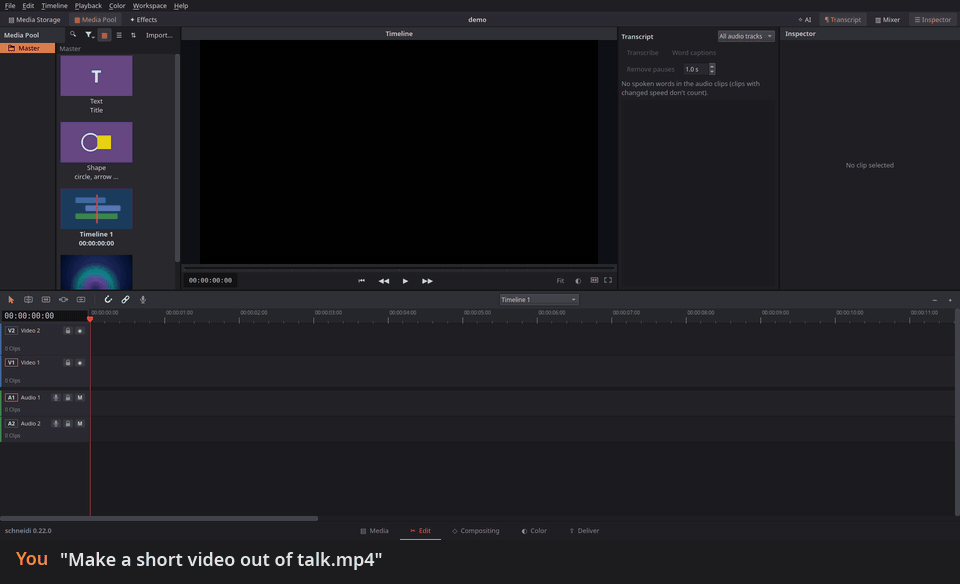

<p align="center">
  <a href="https://github.com/ZenITDigital"></a><br>
  <b>💛 A huge thank you to <a href="https://github.com/ZenITDigital">@ZenITDigital</a></b><br>
  for sponsoring the Claude Max plan that schneidi is developed with.
</p>

## Why schneidi?

- **Edit together with an AI – any AI, any way.** Tell it what to do in the [AI chat](#ai-chat-in-the-app) next to the timeline (Claude, an OpenAI-compatible service or a local model), connect Claude Code or Claude Desktop in one step, or let an assistant work through the [command line and MCP server](#command-line-and-ai-editing-mcp), also on a server. It finds pauses, scene changes, loud moments and the beats of a song, transcribes, cuts, grades, mixes and renders – and you see what it does: changed clips light up, the AI log lists every step, each change is an undo step. Or review first and accept or discard the whole request.
- **From a recording to a short.** A 9:16 short lives next to the 16:9 edit in the same project. Auto reframe keeps the subject in view (and a game's kill feed readable at the top), word-by-word captions come from the speech, and presets for YouTube Shorts, Instagram Reels and TikTok go with a check of the platform's length limit and loudness. An AI can do all of it in one call: `schneidi-cli short` turns game recordings into a finished short.
- **One template, many videos.** Mark the clips, texts, song and logo of an edit as placeholders and it becomes a template: drop new clips onto it in the app, or let a script or an AI fill it from a table – one finished video per product, episode or match, all with your brand kit's logo, colors and fonts.
- **Layers, masks, keying and tracking – with nodes or as layers.** The Comp page shows a clip's compositing as a simple layer stack or as a node graph: key a green screen, put text behind a person, blur a face that moves, stick a logo onto a surface. Ready recipes do the common jobs in one click, and an AI builds the same graphs through the command line.
- **A professional workflow on any computer.** Pages for each step, ripple, roll, slip and slide trims, compound clips, multicam, color wheels and scopes – with the shortcuts you know from the big editors (a standard and a beginner preset, every key changeable), but light enough for an older laptop.
- **Everything stays on your computer.** Speech recognition (whisper.cpp), text-based editing, sync by sound and rendering work offline – no account, no cloud, no telemetry, open source (AGPL-3.0-only). The only request schneidi makes by itself is a check for a new release on GitHub, at most once a day (off in File › Settings). The AI chat talks only to the provider you pick; with Ollama it stays on your computer too.
- **Long recordings of one event.** Sync hours of recordings from several PCs or cameras by their sound and cut them in a multicam view that shows up to 16 angles at once.

## Screenshots

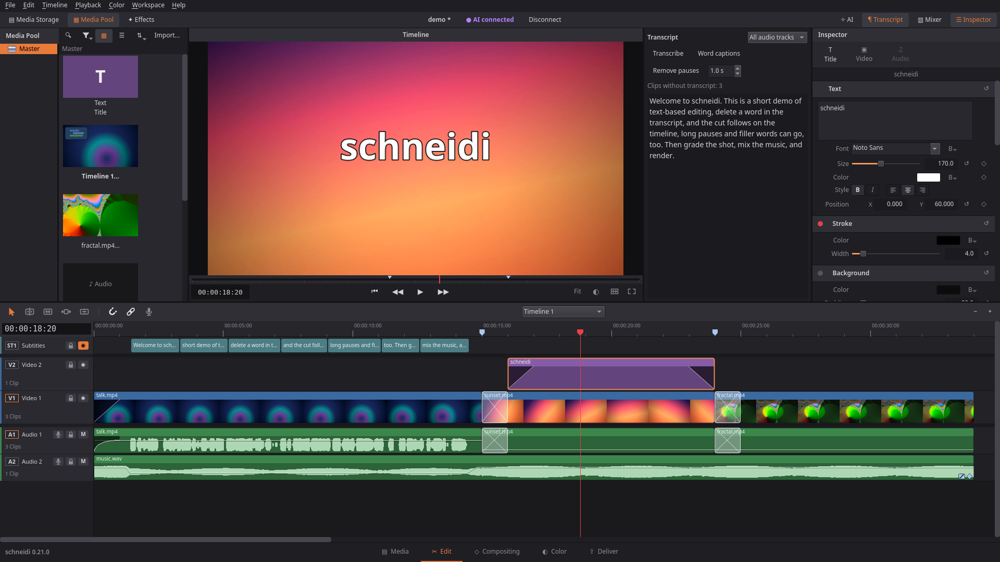

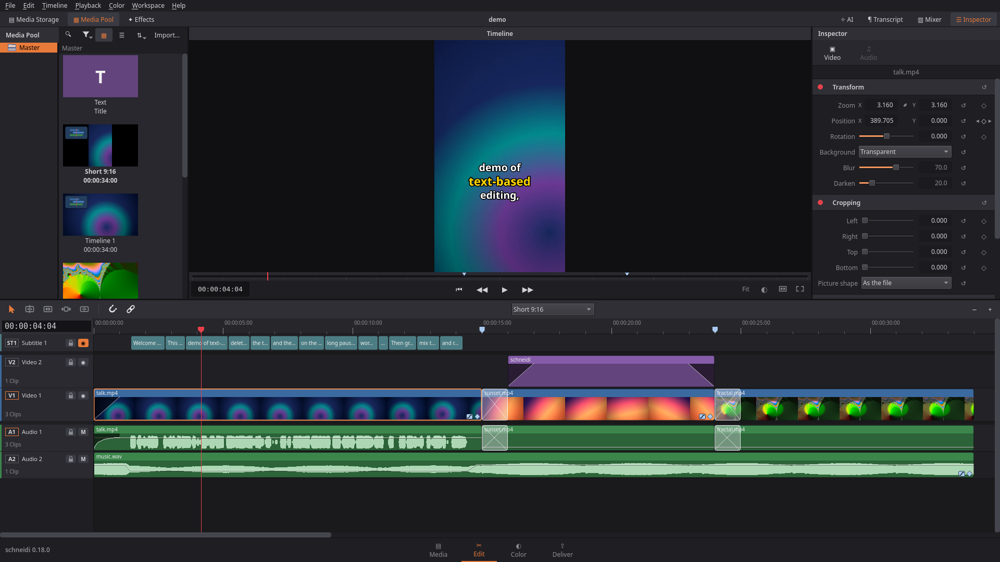
**Short** – the 16:9 edit copied into a 9:16 timeline of the same project: reframed, with karaoke captions from the transcript

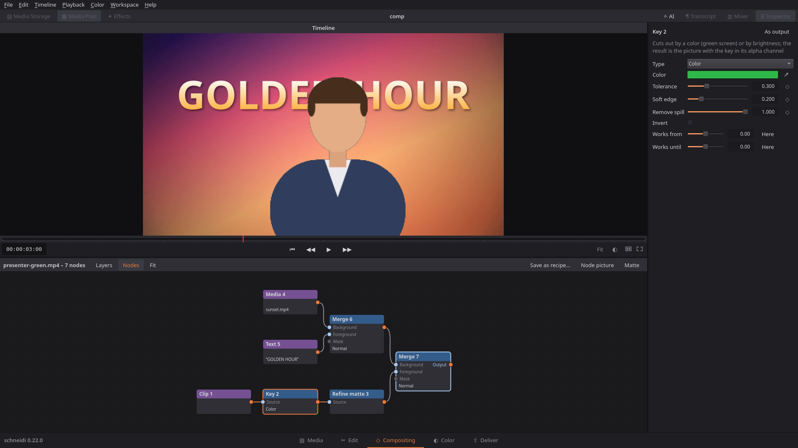
**Comp** – the "text behind subject" recipe as nodes: key and refine the screen, a background and a title behind the person

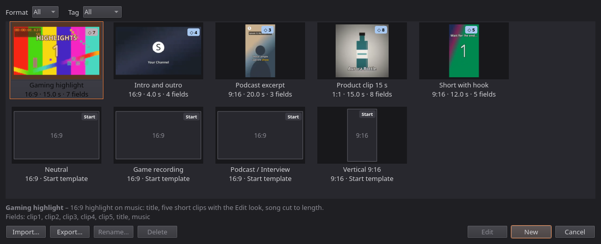
**Templates** – File › New from Template…: each template with its preview, format, length and fields; drag your clips onto the fields, or fill it from a table with `schneidi-cli template fill`

| | |
|---|---|
| [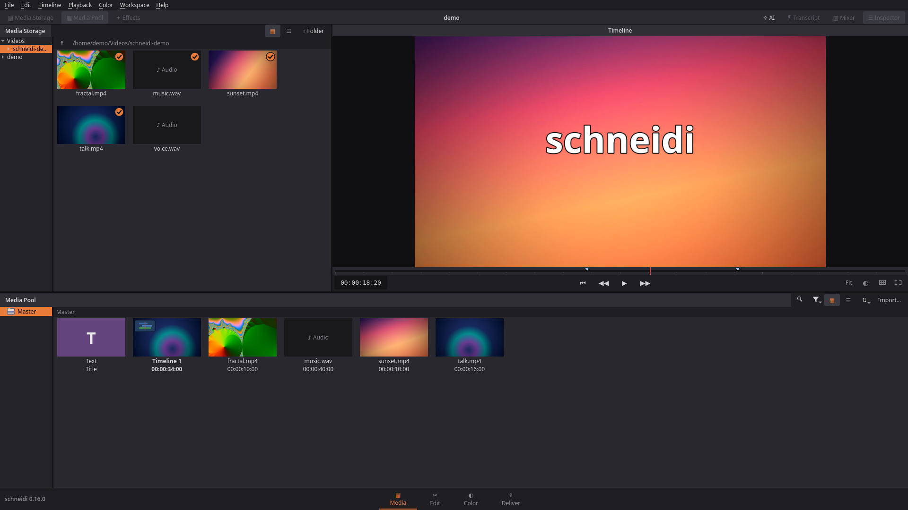](screenshots/media.png)<br>**Media** – browse and skim folders, import into the Media Pool | [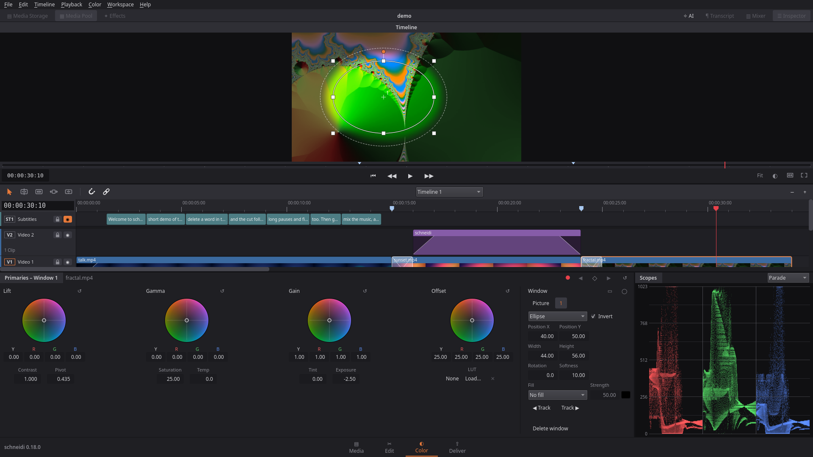](screenshots/color.png)<br>**Color** – color wheels, windows, LUTs, scopes |
| [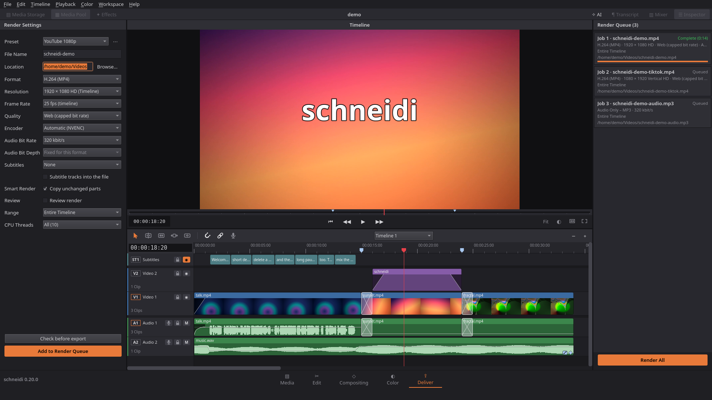](screenshots/deliver.png)<br>**Deliver** – presets and render queue | [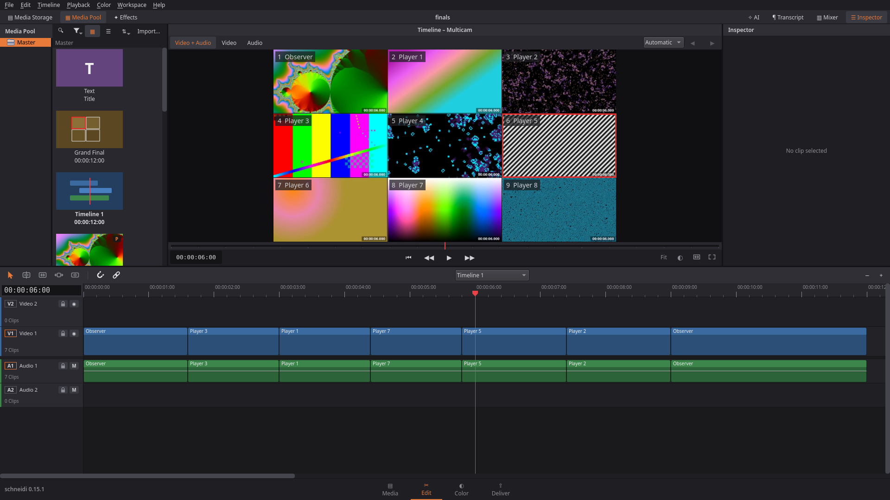](screenshots/multicam.png)<br>**Multicam** – click an angle or press 1–9 to cut to it |
| [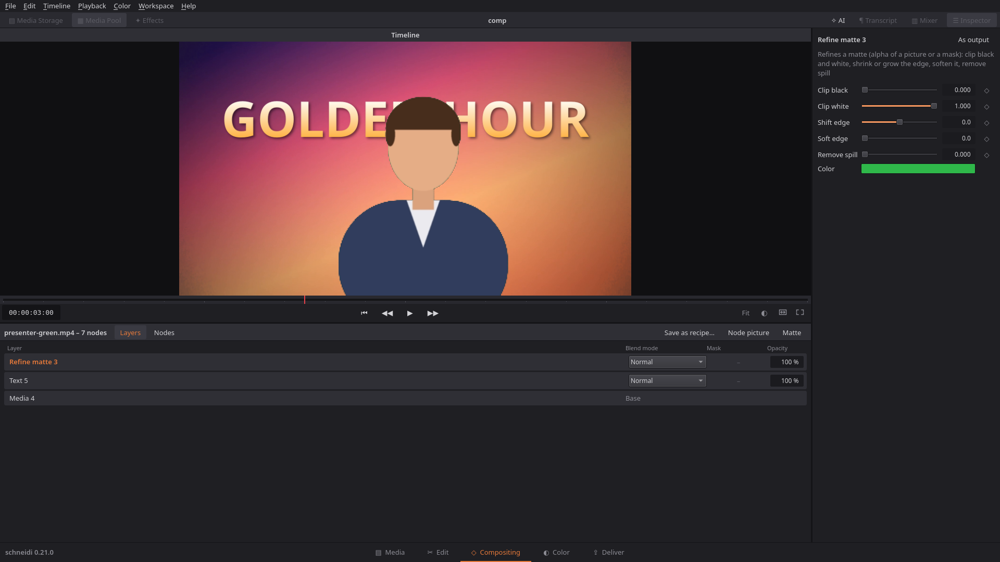](screenshots/comp-layers.png)<br>**Layers** – the same graph as a stack: blend mode, mask, opacity | [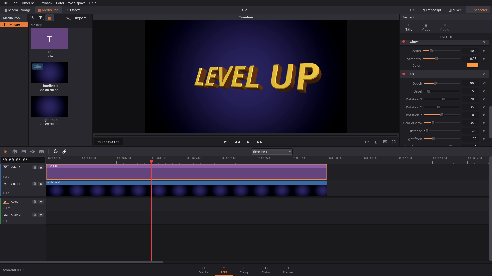](screenshots/title3d.png)<br>**3D titles** – real extruded letters with bevel, light and rotation |

## Features

- Multiple video and audio tracks: cut, trim, move, snapping, undo/redo
- **Multicam:** a multicam clip from several recordings of one event, synced by sound, markers, In points or start; the viewer shows up to 16 angles at once (more on pages) – click or press 1–9 to cut, change angles later, flatten to normal clips
- Timeline zoom and scroll change **only on user input** – nothing jumps when clips get shorter
- Fully customizable keyboard shortcuts and mouse side buttons, two per function – presets (standard or beginner) and whole sets to save and load; panel sets for the Edit page, panel sizes remembered per page
- **Start templates:** begin a project as a game recording, a podcast/interview or a vertical 9:16 video – or save your own setup (tracks, names, muted mix) as the start of every new project
- **Templates:** a finished video from a template in one step – mark clips, titles, the song and the logo of any project as placeholders, then fill them by dragging files from the Media Pool onto them (File › New from Template… shows every template as a tile with preview, format, length and fields). A clip that is too short is trimmed, slowed, frozen or looped as the placeholder says, other shapes are reframed, long text gets smaller, the song is cut to length on its phrases. Five built in (a short with a hook, a gaming highlight on music, a 15 s product clip, a podcast clip, an intro/outro with logo); save your own and pass them on as a ZIP
- **Many videos from a table:** one template, a CSV from Excel or a JSON list – one project and one video per row (`schneidi-cli template fill product-15s --rows products.csv --out_dir out`), e.g. a clip for every product
- **Brand kit** (Workspace › Brand Kit): your logo with its corner and size, up to four colors, two fonts and an intro/outro clip – set once for all projects, changeable per project; titles take "brand color 1" instead of a fixed value and follow when the kit changes; logo and intro/outro go into the timeline only when you ask
- **Media Storage and Media Pool:** look at a file and skim through it before importing, set In/Out and insert; filter the pool by flag, clip color and type; remove clips together with their uses in the timeline in one undo step
- **Watch folders:** new files in a folder (your screen recorder's, for example) come into the Media Pool by themselves – only once they are finished; `schneidi-cli watch` for automatic workflows
- Large viewer (one click hides the panels beside it) and full-screen viewer
- **Compositing (Comp page):** a node graph on any clip, shown as layers (blend mode, mask, opacity per layer) or as nodes with links; nodes for clips, files, colors, gradients, text, merge, transform, crop, blur, grade and any effect; handles in the viewer; "Comp from Selection" turns stacked clips into one graph with the same picture
- **Masks and keying:** rectangle, ellipse, polygon, bezier and gradient masks (soft edge, invert, combined), mattes from luma or alpha; a chroma and luma keyer with spill removal and a matte refiner (grow/shrink, soften, clip black and white)
- **Tracking:** one point, two points (position, scale and rotation – for a sticker on a surface) or a face; masks and transforms follow the tracker
- **AI cutout** (an optional extension): cuts out a person without a green screen, for text behind them or a new background
- **Recipes:** green screen, text behind the subject, a blurred face that follows, picture-in-picture with a frame, a title with a mild glitch, a tracked sticker – one click in the Effects Library; save your own graph as a recipe and share it as a ZIP
- **Write your own effects:** an FFmpeg filter chain or your own GLSL shader as an effect – written by you or an AI; code that comes with someone else's project or recipe runs only after you say you trust it
- Titles (also an animated counter and a progress bar) with **title looks** – gradient or texture fill, a 2.5D edge, drop shadow, glow – and **real 3D text** (extruded, beveled, lit, turned in space), subtitles, fades, transitions (dissolves, dips, wipes, push and whip), volume, loudness normalization
- Color correction, curves, LUTs, effects with keyframes in any order; a built-in **Edit look** preset (teal shadows, warm highlights, skin kept, a soft glow) in one click; copy and paste grades (`=`/`-`); the timeline filmstrip and the Media Pool show the grade; green screen with an eyedropper on a large picture of the clip
- **A format per timeline:** a 9:16 short (or 1:1, 4:5) next to the 16:9 edit in one project; copy a timeline into another shape in one step; pasting between timelines of different shapes converts positions
- **Auto reframe:** footage fills a frame of another shape and follows its subject – the view holds still, moves smoothly and jumps only at scene cuts; in game footage the kill feed stays readable as a cropped copy at the top. Or fit the whole picture in with a blurred copy around it, on one track; **accents** (zoom punch, flash, shake) on hits and drops in one click
- **4:3 game footage:** black bars are found and cropped; a 4:3 game that the recorder stretched to 16:9 is unstretched (per clip, per file or as a watch folder preset) and shown with black bars or blurred sides
- **Blur names:** finds player names in CS2 recordings (team list, kill feed, chat, the name bar; a Valorant template exists but is less tested) and covers them with blur windows that you check on the Color page – own text detection on your computer, no OCR service; small name tags in the 3D picture are often missed
- **Windows** on the Color page (rectangle, ellipse, soft edge, invert): grade only part of the picture, or blur, pixelate or cover a region (a face, a name, an overlay); **tracking** makes a window follow a moving object
- Video stabilization and audio noise reduction (own implementations)
- **Clean Voice** (a button in the Mixer): removes background noise (RNNoise) and evens out the level of speech in one step; pauses keep a quiet room tone instead of going silent
- **Voice-over recording:** arm a track and record from the microphone while the timeline plays; the take lands exactly where you heard it (input latency compensated)
- **Text to speech** (Piper, offline, an optional download): type a narration and get a voice clip with word captions; English and German voices
- Own effects (green screen with spill removal, glow, halftone …); import effect presets from Kdenlive and Shotcut
- Video scopes: waveform, RGB parade, vectorscope, histogram
- Slip and slide tools; two-up/four-up trim view while dragging an edit
- **Own audio engine (SMT):** sound is read, mixed and played sample-exact – lips in sync within about 1 ms in the viewer, no clicks when stopping, jumping or moving faders, real 24-bit export; choose the output device, survives an unplugged headset
- Loudness and true-peak meters, master limiter that holds a true-peak ceiling
- Per-track EQ (6 bands) and compressor in the mixer, ducking (music goes down while someone speaks)
- Files with several audio streams (OBS): import presets per stream title – mute the mix, leave out streams, name the tracks
- Clip speed / retime; **smooth slow motion** with in-between frames (blended, or computed from the motion with an own optical flow; never across a scene cut) – chosen in the speed dialog (Ctrl+R)
- **Timeline exchange:** import and export FCP7 XML, OpenTimelineIO and EDL – bring a cut over from Premiere Pro or DaVinci Resolve, or hand one over for finishing
- Own video decoding, also on the graphics card (NVIDIA, AMD/Intel via VA-API); proxy media and a render cache for smooth playback – schneidi offers proxies when playback cannot keep up
- Export and render queue via FFmpeg: H.264, H.265, AV1, VP9 (WebM), ProRes and DNxHR, animated GIF, PNG/TIFF/JPEG image sequences and audio only (AAC, MP3, Opus, WAV, AIFF, FLAC, Apple Lossless); hardware encoders (NVENC, VAAPI, Quick Sync) when available, else OpenH264/kvazaar, or x264/x265 as an optional download (Extensions); presets for YouTube, YouTube Shorts, Instagram Reels and TikTok cap the bit rate; **Smart Render** copies unchanged parts of H.264/H.265 recordings instead of encoding them again
- Subtitles from speech (whisper.cpp, offline) – pick the voice tracks, one subtitle track each; in game recordings with a separate microphone stream it listens to the microphone, so song lyrics stay out of the subtitles; an optional download under Workspace → Extensions
- **Word captions:** karaoke (the spoken word lights up), one word at a time, or one word per beat of the music, from the transcript's word times; export as SRT or WebVTT, or as a subtitle stream inside the MP4/MKV/WebM
- Text-based editing: the Transcript panel shows what is said – delete words to cut them, remove pauses
- **Check before export:** one click on the Deliver page (or `check` for an AI) finds what often goes wrong in finished videos – a forgotten frame between two clips, missing files, subtitles too short or too fast to read, clipping, loudness off the target, silence at the end, game sound buried under the music, text that TikTok/Reels/Shorts cover, black bars, stutter in recordings, and for an AI also the platform's length limit (`check --for tiktok`); one click fixes peaks and loudness (master limiter and fader)
- `schneidi <file>` while the app runs hands the file over: a project opens, a video lands in the open project's Media Pool; File › Open Video as Project starts a project in the video's own format
- Contact sheet: stills of the timeline with timecodes as one picture (File › Save Contact Sheet)
- **AI chat in the app:** tell an AI what to do in the open project – Claude, OpenAI-compatible services (OpenAI, OpenRouter, LM Studio, your company's proxy …) or a local model with Ollama; automatic or review mode ([details](#ai-chat-in-the-app))
- **See what an AI does:** clips it adds or changes light up in the timeline, the AI log lists every step (a click jumps there), its analyses and renders show with progress
- **AI director:** a searchable index of your footage (every shot with its quality, what is said and heard; search "where does he laugh"), the edit laid out as a story with a hook and a payoff and checked for pace, the AI's cut plan shown with a reason per step before anything changes, and a review render with cuts, beats and hits burned in for checking its own work
- **Effect sounds** (Effects › Sounds, or op `sfx`): CC0 recordings and computed risers for whooshes, hits, impacts and clicks, set as loud as the sound where they land – only where you put them or ask for them, never by themselves; your own sounds from the effects folder too
- **Sound-aware cutting:** J/L cuts and room tone, a song cut to the video's length on its phrases with its real ending, events snapped to the beat, a rough cut from a script with the best take of each line, jump cuts hidden by a zoom, B-roll that matches what is said
- **Command line and MCP server** (`schneidi-cli`, locally or over HTTP on a server): scripts or an AI assistant can edit almost everything the app can – find pauses, scene changes, loud moments and events in a part of the picture (kill feed, score), pick highlights (your own kills, loud fights), make a finished short of game recordings in one call, build compositing graphs (recipes, keys, masks, trackers, cutouts), fill templates (also one video per row of a table) and apply a brand kit, sync recordings by their sound, build multicam clips, transcribe, cut and trim, grade, animate, mix, duck music and normalize, measure loudness, look at frames (or a detail of them) and scopes, render ([details](#command-line-and-ai-editing-mcp))
- Themes, six UI languages (English, German, Spanish, French, Polish, Russian)

## How light is it?

Measured on two desktop CPUs restricted with Linux cgroups (cores, RAM, no swap) – stand-ins for old hardware, not a real old laptop: a Ryzen 5 5600X (with 0.11) and a Ryzen 5 PRO 2400G (2018, 4 cores, built-in Vega graphics; with 0.13). Each cell: **5600X / 2400G**.

**Starting:**

| 5600X / 2400G | Empty project | Project with a 1080p clip |
|---|---|---|
| Least RAM it starts and keeps running with | 128 / 112 MB | 288 / 288 MB |
| Window visible, one full core | 0.6 / 0.7 s | 0.5 / 0.8 s |
| Window visible, 10 % of one core | 6 / 11 s | 6 / 12 s |
| Window visible, 5 % of one core | 11 / 25 s | 15 / 25 s |

RAM in steps of 16 MB (the 2400G was measured in a Docker container, the 5600X in a systemd scope). Thumbnails for the Media Storage (your Videos folder) are made by a separate ffmpeg at the start; for a large file that takes up to ~100 MB more for a moment.

**But starting is not the same as editing smoothly.** Playback of a demanding project (12 gaming clips, 1080p60 at 140 Mbit/s, a grade on every clip), frames per second out of 60 over 15 s, the start-up included – from about 52 on it plays a steady 60 after the first second or two:

| CPU (5600X / 2400G) | From the original files | Originals, decoded on the graphics card | From proxies |
|---|---|---|---|
| 1 core | 12 / 11 – stutters | 55 / 53 | 57 / 53 |
| 2 cores | 44 / 16 – stutters on the 2400G | 59 / 54 – smooth | 57 / 57 |
| 4 cores | 57 / 53 – smooth | | |
| All cores (6 / 4 with SMT) | 58 / 57 – smooth | | |

0.10 managed 3.6 frames/s on one core and 9 on two: 0.11 decodes the video itself. Decoding on the graphics card (NVIDIA, AMD/Intel via VA-API; here a GTX 1070 and the 2400G's built-in Vega 11) is on by default – with it one core is enough even on the 2400G. On a computer too slow for the originals, schneidi notices it during playback and offers to generate proxy media (also by hand: right-click a clip in the Media Pool › Generate Proxy Media). Playback › Clean Up Proxy Media… lists the proxy files no open or recent project needs (original deleted or changed, project gone) and frees their space. A few seconds after playback stops or an export ends, schneidi gives the memory it no longer needs back to the system (after a 1080p export about 1450 → 590 MB).

**And on real weak hardware: a Raspberry Pi Zero 2 W** (4 × 1 GHz Cortex-A53, 512 MB RAM, Debian 13 ARM64, no hardware decoding; built from source, there is no ARM download yet). DaVinci Resolve, Premiere Pro and Final Cut Pro are not available for this computer at all. Material: 15 s of a 1080p60 gaming clip.

| | Raspberry Pi Zero 2 W |
|---|---|
| Window visible | 6.5 s, 180 MB RAM |
| Playback 720p30 original | 29 of 30 frames/s, sound in sync |
| Playback 1080p60 original | 1 frame/s – the Pi cannot even decode it in real time |
| Playback 1080p60 from proxies | 59 of 60 frames/s, sound in sync |
| Jumping in the timeline, original → proxies | 2 s → 0.07 s |
| Export 5 s of 720p (x264) | 82 s |

## Performance

Measured, not estimated: the large 1080x1920 test project (27 clips, about 60 titles) renders in about 37 s with 1.5 GB of RAM since 0.15.0 (0.14.1: 59 s, 4.3 GB), an empty project starts in about 0.4 s, and a Raspberry Pi Zero 2 W with 415 MB of RAM opens the window in under 5 s. 8K footage is editable with proxies; 8K60 without proxies is not smooth. Every benchmark run on record, including the ones that got worse, is in [BENCHMARKS.md](BENCHMARKS.md).

## AI chat in the app

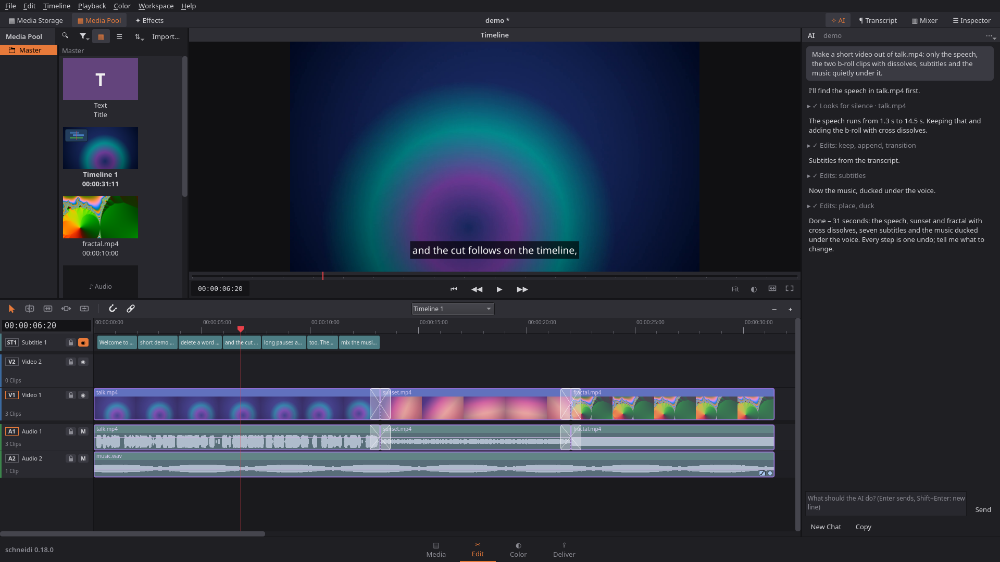

Click **✧ AI** in the top bar and tell an AI what to do in the open project – "remove every pause longer than a
second", "put the subtitles on and make them bigger", "cut the clips to the beat of the song". It uses the same tools
as every other AI ([below](#command-line-and-ai-editing-mcp)), looks at frames, measures the sound and works while
you watch: changed clips light up, each change is an undo step. In **review mode** (File › Settings › AI) the changes of a
request show in the timeline and preview first; then **Accept** keeps them as one undo step and **Discard** puts the
project back.

- **Providers:** Claude (Anthropic), OpenAI, OpenRouter, Ollama on your computer, or any address that speaks the
  OpenAI chat API (LM Studio, vLLM, Mistral, Groq, a company proxy …). The model name is free to change. A local model
  needs a context of about 32k tokens for the tools and the editing guide (Ollama: `OLLAMA_CONTEXT_LENGTH=32768`).
- **Keys:** from the environment (`SCHNEIDI_AI_KEY`, or `ANTHROPIC_API_KEY` / `OPENAI_API_KEY` / `OPENROUTER_API_KEY`
  for that provider only), else from the system keychain (Secret Service, Windows Credential Manager). Keys never go
  into logs or the chat.
- **For companies:** a `schneidi-ai.json` in `/etc/xdg/schneidi` or `~/.config/schneidi` (Windows:
  `C:\ProgramData\schneidi\schneidi`) sets `provider`, `address`, `model` and `key` or `key_file`;
  `"locked": true` keeps users on that provider.
- **Privacy:** before the first message to a cloud provider schneidi says once what goes there (project contents,
  frames, transcripts). The chat history stays in memory only. The panel shows the tokens of the chat.

## Command line and AI editing (MCP)

`schneidi-cli` edits the same project files without a window, for scripts and AI assistants. A typical rough cut:
let the AI find the pauses, keep the rest, look at the result, render, then fine-tune in schneidi.

```bash
schneidi-cli new talk.schneidi --fps 25 --media talk.mp4
schneidi-cli overview talk.mp4                               # first look: loudness, silence, motion, cuts per stretch
schneidi-cli silence talk.mp4 --project talk.schneidi        # "sound" ranges without the pauses
schneidi-cli scenes broll.mp4 --project talk.schneidi        # shot changes
schneidi-cli scenes game.mp4 --region 0.75,0.05,0.25,0.3     # events in a part of the picture (kill feed)
schneidi-cli peaks game.mp4 --top 10                         # the loudest moments
schneidi-cli beats song.mp3 --project talk.schneidi          # tempo, bars, phrases, breaks and drops of a song
schneidi-cli highlights game.mp4 --region 0.70,0.04,0.22,0.23 --color "#e7e371"  # own kills (Valorant), best first
schneidi-cli sync cam1.mp4 cam2.mp4 cam3.mp4                 # offsets of recordings of the same event
schneidi-cli short game1.mp4 game2.mp4 --for tiktok          # best moments → reframed 9:16 short with captions, checked, rendered
schneidi-cli templates                                       # start and content templates; `template info short-hook`: its fields
schneidi-cli template fill short-hook --values '{"hook":"Wait for it","clip1":"/clips/a.mp4"}' --out_project short.schneidi --render '{}'
schneidi-cli brand --action set --colors "#ffcc00,#202020" --fonts Inter --logo logo.png   # your brand kit
schneidi-cli extensions --install whisper,small              # optional speech recognition (download, ~200 MB)
schneidi-cli transcribe talk.mp4 --language de --words       # what is said, with word times
schneidi-cli edit talk.schneidi --ops '[{"op":"keep","media":"talk.mp4","ranges":[[0,250],[310,900]]}]'
schneidi-cli edit talk.schneidi --ops '[{"op":"comp","clips":[4],"recipe":"greenscreen","with":{"background":"beach.jpg"}}]'
schneidi-cli frames talk.schneidi --clip 4 --node 2 --view matte --out key.jpg   # is the key clean?
schneidi-cli frames talk.schneidi --count 9 --sheet --out sheet.jpg
schneidi-cli scopes talk.schneidi --at 10s --out scopes.png      # waveform, parade, vectorscope + numbers
schneidi-cli loudness talk.schneidi                          # LUFS, true peak of the mix
schneidi-cli check talk.schneidi                             # before export: gaps, missing media, subtitles, sound
schneidi-cli render talk.schneidi --out talk-cut.mp4 --preset "YouTube 1080p"
schneidi-cli export_timeline talk.schneidi --out talk.xml       # for Premiere / DaVinci (also .otio, .edl)
schneidi-cli import talk.schneidi --timeline_file premiere.xml   # a cut from Premiere / DaVinci as a new timeline
schneidi-cli restore talk.schneidi                           # undo the last change (file mode)
schneidi-cli help                                            # all commands (JSON)
schneidi-cli help edit                                       # every edit operation with details
schneidi-cli help edit --op speed_ramp                       # one edit operation
```

Edit operations cover cutting, inserting and source edits (insert, replace, place on top, fit to fill), moving,
trimming (ripple, roll, slip, slide), titles with their style, fades, transitions (dissolve, dip, wipes, luma),
speed and speed ramps (with in-between frames), markers, subtitles (SRT or cue lists, track styles) and word captions, effects and presets, the color grade
(wheels, LUTs, windows with blur/pixelate and tracking), transform and crop, reframe to another shape, black bars and stretched 4:3, blurring player names, keyframes for any animatable value, paste attributes, volume/pan, the mixer
(also to a loudness target, EQ and compressor per track), ducking, loudness normalization, voice cleaning, text to speech, tracks, linking, compound
clips, compositing graphs (`comp` with recipes, `comp_from`, `node`, trackers with `track_node`, AI cutouts with `cutout_node`), template placeholders (mark, fill), multicam clips (create, cut to an angle, change angles, flatten), several timelines (each with its own format) and the project format. Positions can be given relative to a clip or to the source material (`{"clip": 12, "source":
"34.2s"}`), so they stay right while earlier operations move clips. Output is JSON on stdout (exit code 0 = ok,
1 = error, 2 = usage error); every save keeps a backup of the previous state (`backups`, `restore`). `schneidi-cli mcp` runs the same commands as an [MCP](https://modelcontextprotocol.io) server on stdio.

**Connect Claude in one step:** `schneidi-cli setup claude` (AppImage: `./schneidi-<version>-x86_64.AppImage cli setup claude`,
or File › Settings › AI › Connect with Claude…) adds the MCP server to Claude Code and Claude Desktop with the path of this installation (run it again when the AppImage has a new name after an update), and installs the editing guide as a
skill for Claude Code ([skills/schneidi](skills/schneidi/SKILL.md): workflow and how-tos for highlight reels, talking
heads, shorts, ads, templates, subtitles, color, compositing, sound). `--only code` / `--only desktop` picks one, `--remove` takes it out again.
Every other AI gets the same guide through the `guide` tool. By hand: `claude mcp add --scope user schneidi --
schneidi-cli mcp`, or in Claude Desktop's `claude_desktop_config.json`:

```json
{ "mcpServers": { "schneidi": { "command": "/path/to/schneidi-cli", "args": ["mcp"] } } }
```

**Live with the app:** if the project is open in schneidi, every command works on what the app shows (unsaved
changes included). An `edit` changes the open project as one undo step and does not save; `info` adds the playhead
and the selection; `app` plays, seeks, selects, undoes, saves, generates proxies and cleans up old ones. The app shows "AI connected"
while a session is active, lights up the clips it changed and has a button to disconnect it. `@app` as the project
means the project of the running app. Without the app (or on a server) the CLI works on the file as before.

```bash
schneidi-cli app state                                       # playhead, selection, open timeline
schneidi-cli edit @app --ops '[{"op":"split","at":"12s"}]'   # cut in the open project
schneidi-cli app undo
```
The AppImage contains the CLI too: `./schneidi-<version>-x86_64.AppImage cli help`, or a link to the AppImage named `schneidi-cli`.

**On a server (HTTP, Docker):** `schneidi-cli serve` runs the same tools as an MCP server over HTTP, so AIs on other
devices and fully automatic pipelines can edit on a server: material goes in by `PUT /files/…` or the `upload` tool,
results come back as download links, long renders turn into jobs (`jobs`), and nothing outside the work folder
(`--root`) can be read or written. It listens on localhost by default; on the network or behind a reverse proxy (`--public-url`) a token is required. A Docker
image (`ghcr.io/onkeltheorie/schneidi`, from 0.12.0) with compose file is in [packaging/docker](packaging/docker/README.md).

```bash
schneidi-cli serve --root ~/videos                            # http://127.0.0.1:8642/mcp
claude mcp add --transport http schneidi http://127.0.0.1:8642/mcp
```

## Roadmap

What we are working on next. Plans can still change; the order within a version is not fixed.

### 0.19 – Compositing Update (in testing)
Layers, masks, keying, tracking – with nodes or as layers. A Comp page with a layer view and a node canvas, masks, a keyer, an AI cutout (extension), a basic tracker (one point, two points, faces – more in the next update), title looks (gradient, texture, 2.5D edge, shadow, glow), real 3D text, six recipes, own effects as an FFmpeg filter chain or a GLSL shader (with a trust question for shared projects), common graphs on the graphics card, and all of it for an AI through the command line and MCP – done, being tested for release.

### Next: 0.20 – Newcomer Update
Guided tours in the app (first steps, editing, color, compositing; green screen and tracker guides), hide pages you don't use, preview on a second monitor, clips tilted in 3D, Premiere/Final Cut key presets.

### Later
- **0.21 – Tracking Update:** better tracking: fade out when the point is lost, a node's time range on the timeline, text behind a wall, four-corner tracking, a shared camera for 2.5D
- **0.22 – Studio:** a page for sound – a big mixer, large waveforms, volume curves to draw, EQ and compressor per track, voice cleanup, loudness, recording
- **0.23 – Color Update 2:** curves on the Color page, qualifier (select by hue, saturation and lightness), more scope overlays

## Building

C++20, Qt 6 Widgets, FFmpeg libraries (own picture and audio engine), CMake.

**Linux (Debian/Ubuntu):**

```bash
sudo apt install build-essential cmake ninja-build pkg-config qt6-base-dev qt6-base-private-dev libavformat-dev libavcodec-dev libswresample-dev libswscale-dev libavutil-dev libminiaudio-dev
cmake -S . -B build -G Ninja && cmake --build build && ./build/schneidi
```

Optional: `libavfilter-dev` (effect "FFmpeg filter": a filter chain on a clip) and `qt6-shader-baker` (effect "Shader": own GLSL effects, compiled at run time by its `qsb` program; GPL-3, so the GPL-free AppImage/Windows packages do not bundle it - an installed one is found). Without them those two effects say they are not available; everything else works.

Other distributions: the same libraries (Qt 6 Widgets/Network and its private GUI headers, FFmpeg 7). Without a miniaudio package (openSUSE, Fedora) the build uses the copy in `third_party/miniaudio` (`-DSCHNEIDI_SYSTEM_MINIAUDIO=ON` insists on the system's). Notes for distribution packagers and an openSUSE spec file: [packaging/linux/opensuse](packaging/linux/opensuse).

AppImage: `packaging/linux/build-appimage.sh` → `dist/schneidi-<version>-x86_64.AppImage`, without any GPL library (own LGPL FFmpeg; H.264/H.265 through the graphics card, else OpenH264/kvazaar, or x264/x265 as an optional download in the program: Extensions); bundled libraries and their licenses: [THIRD_PARTY.md](THIRD_PARTY.md)
Debian package (system Qt/FFmpeg, no bundling): `cmake --build build && cpack --config build/CPackConfig.cmake -G DEB` → `dist/schneidi_<version>_amd64.deb`
The .deb is built for Debian 13: it needs exactly its Qt 6.8.2 (the GPU viewer uses Qt's private RHI interface) and FFmpeg 7.1; on every other system use the AppImage.

**Windows:** via [MSYS2](https://www.msys2.org), UCRT64 environment. Clone the repo into a path without spaces or non-ASCII characters, then:

```bash
pacman -S --needed mingw-w64-ucrt-x86_64-{toolchain,cmake,ninja,pkgconf,qt6-base,qt6-svg,ntldd,miniaudio}
pacman -S --needed nasm make diffutils mingw-w64-ucrt-x86_64-{openh264,kvazaar,svt-av1,libvpx,dav1d,opus,lame,libvpl,ffnvcodec-headers}
packaging/windows/build-windows.sh
```

Result: `dist/schneidi-windows-<version>.zip` (portable folder) and, if [Inno Setup 6](https://jrsoftware.org/isinfo.php) is installed (`winget install JRSoftware.InnoSetup`), `dist/schneidi-setup-<version>.exe`. Like the AppImage without any GPL library: the first run builds the own LGPL FFmpeg (`packaging/windows/build-ffmpeg-lgpl.sh`, into `build-ffmpeg-lgpl/prefix` or `FFMPEG_PREFIX`); the installer offers x264/x265 as an optional download. `SCHNEIDI_NO_GPL=0` packs MSYS2's full FFmpeg instead (`mingw-w64-ucrt-x86_64-ffmpeg`, GPL, `…-gpl.zip`) for local comparisons.

**Tests:**

```bash
cmake -S . -B build-tests -G Ninja -DSCHNEIDI_TESTS=ON && cmake --build build-tests && ctest --test-dir build-tests --output-on-failure
```

## Credits

Developed by [OnkelTheorie](https://github.com/OnkelTheorie) with the help of [Claude](https://claude.ai) (Anthropic) as an AI coding assistant.

Sponsored by [@ZenITDigital](https://github.com/ZenITDigital), who pays for the Claude Max plan behind schneidi's development – thank you so much!

## Disclaimer

schneidi is an independent open-source project. It is not affiliated with, endorsed by or sponsored by Blackmagic Design. DaVinci Resolve is a trademark of Blackmagic Design Pty Ltd and is mentioned here for descriptive purposes only.

## License

[AGPL-3.0-only](LICENSE): use schneidi for anything, change it, share it. If you publish a changed version, or offer it to others as an online service, publish your source code too. Versions up to 0.12 are GPL-3.0.

The schneidi released here has no ads, no subscriptions and no telemetry. From 0.14 on the license is plain AGPL-3.0-only: the app store permission that 0.13 carried (linking a store's ad, purchase or license check libraries) is gone. It still applies to the 0.13 versions released with it.

The code is open; the name "schneidi" and the logo are protected, see [TRADEMARKS.md](TRADEMARKS.md). Want to contribute? See [CONTRIBUTING.md](CONTRIBUTING.md).
