# schneidi

**A fast, light video editor that an AI assistant can edit with you – live, in the project you have open.**

schneidi has seven pages – Media, Edit, Compositing, Color, Studio, Direct and Deliver – and fewer features than the big editors, but it starts in under a second, plays a demanding 1080p60 project smoothly on four CPU cores and runs even on a Raspberry Pi. It opens H.264/H.265 video with AAC sound on Linux out of the box – no codec packs, no paid version. The UI is available in 16 languages, from English and German to Japanese, Hindi and Indonesian.

[](https://github.com/OnkelTheorie/schneidi/releases/latest)

**[Download the latest release](https://github.com/OnkelTheorie/schneidi/releases/latest)** (Linux AppImage, Debian package or Arch Linux package). Windows: no download yet – [build it yourself](#building) (tested less thoroughly than Linux); an installer is planned for 1.0. The bundled packages include x264/x265 (GPL) for the best H.264/H.265 quality without a graphics card encoder ([licenses](THIRD_PARTY.md)).

**Try the AI in two minutes:** make the AppImage executable (`chmod +x schneidi-*.AppImage`) and start it, open a video, click **✧ AI** at the top and pick a provider – a local model through [Ollama](https://ollama.com) needs no account (`ollama pull qwen3`, and start Ollama with `OLLAMA_CONTEXT_LENGTH=32768 ollama serve`: the tools and the editing guide do not fit its default context), Claude or an OpenAI-compatible service needs a key. Then type what you want: "remove the pauses", "cut it to the beat".

> Status: early development (0.x). The project file format may still change between versions.

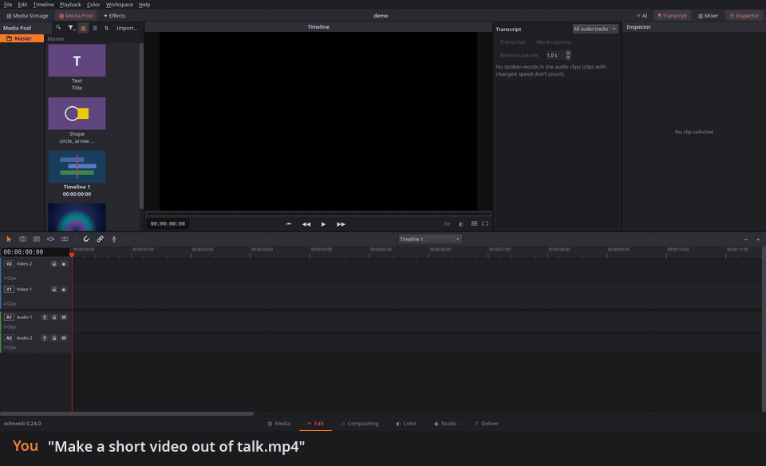

<p align="center">
  <a href="https://github.com/ZenITDigital"></a><br>
  <b>💛 A huge thank you to <a href="https://github.com/ZenITDigital">@ZenITDigital</a></b><br>
  for sponsoring the Claude Max plan that schneidi is developed with.
</p>

## Why schneidi?

- **Edit together with an AI – any AI, any way.** Tell it what to do in the [AI chat](#ai-chat-in-the-app) next to the timeline (Claude, an OpenAI-compatible service or a local model), connect Claude Code or Claude Desktop in one step, or let an assistant work through the [command line and MCP server](#command-line-and-ai-editing-mcp), also on a server. It finds pauses, scene changes, loud moments and the beats of a song, transcribes, cuts, grades, mixes and renders – and you see what it does: changed clips light up, the AI log lists every step, each change is an undo step. Or review first and accept or discard the whole request.
- **From a recording to a short.** A 9:16 short lives next to the 16:9 edit in the same project. Auto reframe keeps the subject in view (and a game's kill feed readable at the top), word-by-word captions come from the speech, and presets for YouTube Shorts, Instagram Reels and TikTok go with a check of the platform's length limit and loudness. An AI can do all of it in one call: `schneidi-cli short` turns game recordings into a finished short.
- **Clips in, a cut out – without a chat AI.** On the Direct page you drop your clips and pick a recipe: a short, a highlight video, a talk without pauses, a filled template or a rough cut from a script. schneidi lists suggestions with a reason for each ("3 loud moments", "laughter", "pause 1.4 s"), you switch them on or off, move or reorder them, and Accept builds the timeline as one undo step – with background music of its own when you want it.
- **One template, many videos.** Mark the clips, texts, song and logo of an edit as placeholders and it becomes a template: drop new clips onto it in the app, or let a script or an AI fill it from a table – one finished video per product, episode or match, all with your brand kit's logo, colors and fonts.
- **Layers, masks, keying and tracking – with nodes or as layers.** The Compositing page shows a clip's compositing as a simple layer stack or as a node graph: key a green screen, put text behind a person, blur a face that moves, stick a logo onto a surface. Ready recipes do the common jobs in one click, and an AI builds the same graphs through the command line.
- **A professional workflow on any computer.** Pages for each step, ripple, roll, slip and slide trims, compound clips, multicam, color wheels and scopes, a sound page with automation and 5.1/7.1 surround – with the shortcuts you know from the big editors (a standard and a beginner preset, every key changeable), but light enough for an older laptop.
- **Everything stays on your computer.** Speech recognition (whisper.cpp), text-based editing, sync by sound and rendering work offline – no account, no cloud, no telemetry, open source (AGPL-3.0-only). The only request schneidi makes by itself is a check for a new release on GitHub, at most once a day (off in File › Settings). The AI chat talks only to the provider you pick; with Ollama it stays on your computer too.
- **Long recordings of one event.** Sync hours of recordings from several PCs or cameras by their sound and cut them in a multicam view that shows up to 16 angles at once.

## Use with AI (MCP)

schneidi is an [MCP](https://modelcontextprotocol.io) server too: Claude Code, Claude Desktop and other MCP clients
can look at your material, cut, grade, mix and render with it – also in the project you have open in the app, where
every change is one undo step.

**Connect Claude in one step:** `schneidi-cli setup claude` (AppImage: `./schneidi-<version>-x86_64.AppImage cli setup claude`,
or in the app File › Settings › AI › Connect with Claude…). It adds the MCP server to Claude Code and Claude Desktop
with the path of this installation and installs the editing guide as a skill for Claude Code
([skills/schneidi](skills/schneidi/SKILL.md): workflow and how-tos for highlight reels, talking heads, shorts, ads,
templates, subtitles, color, compositing, sound). `--only code` / `--only desktop` picks one, `--remove` takes it out
again. Run it again when the AppImage has a new name after an update.

**By hand** – Claude Code:

```bash
claude mcp add --scope user schneidi -- schneidi-cli mcp
```

Claude Desktop (`claude_desktop_config.json`), Cursor and other MCP clients:

```json
{ "mcpServers": { "schneidi": { "command": "/path/to/schneidi-cli", "args": ["mcp"] } } }
```

With the AppImage the command is the AppImage itself and the arguments are `["cli", "mcp"]`. The skill by hand: copy
[skills/schneidi](skills/schneidi) to `~/.claude/skills/schneidi`; every other AI gets the same guide through the
`guide` tool. More – the commands, live editing in the open app, an MCP server over HTTP on a server – in
[Command line and AI editing](#command-line-and-ai-editing-mcp).

## Screenshots

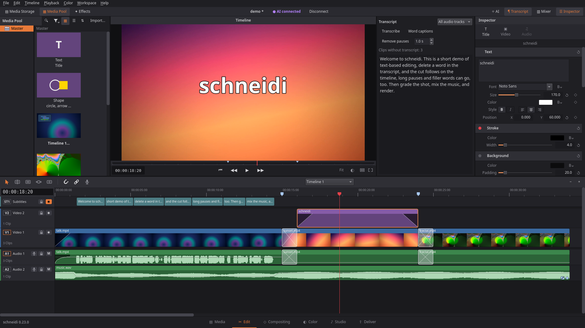

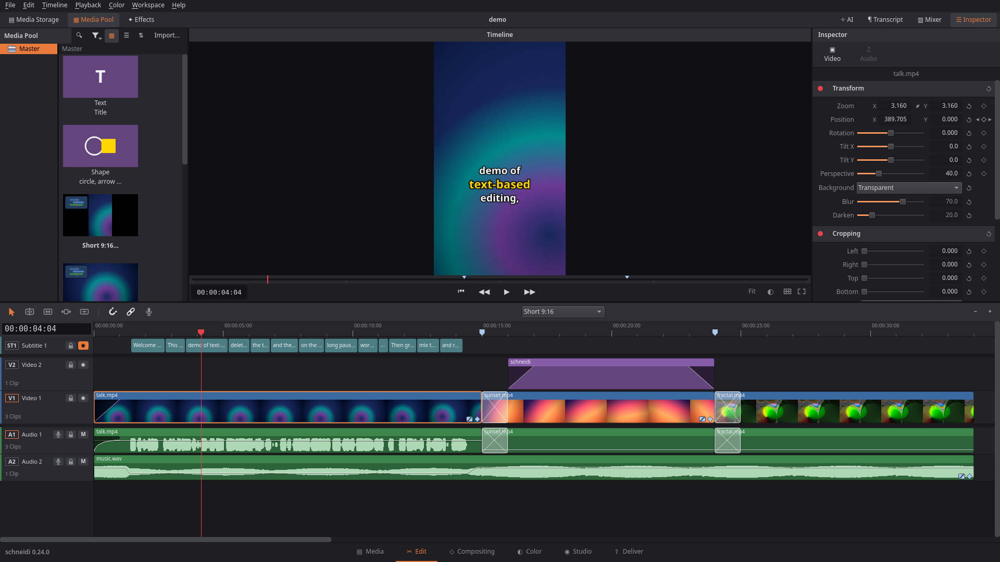
**Short** – the 16:9 edit copied into a 9:16 timeline of the same project: reframed, with karaoke captions from the transcript


**Direct** – clips in, a recipe picked (short, highlights, talk without pauses, template, script): each suggestion with its reason, a click plays it, the checkbox takes it in, Accept builds the timeline as one undo step

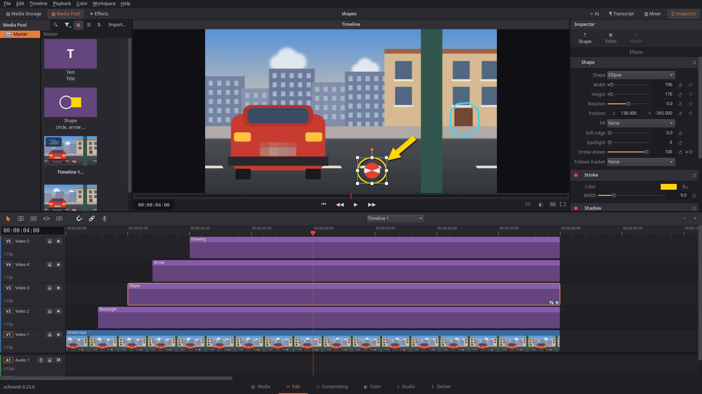
**Shapes and drawing** – circles, arrows, stars and more right on the video, a shape that blurs or pixelates what is below it (a number plate, a name), and strokes painted in the viewer (press P); every shape is a clip you can move, trim, animate or pin to a tracker

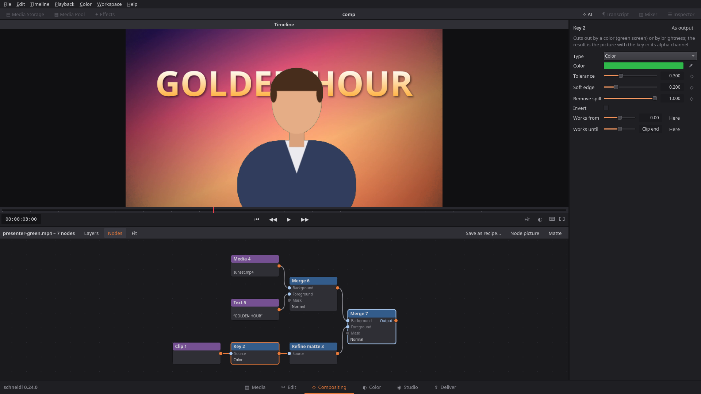
**Compositing** – the "text behind subject" recipe as nodes: key and refine the screen, a background and a title behind the person

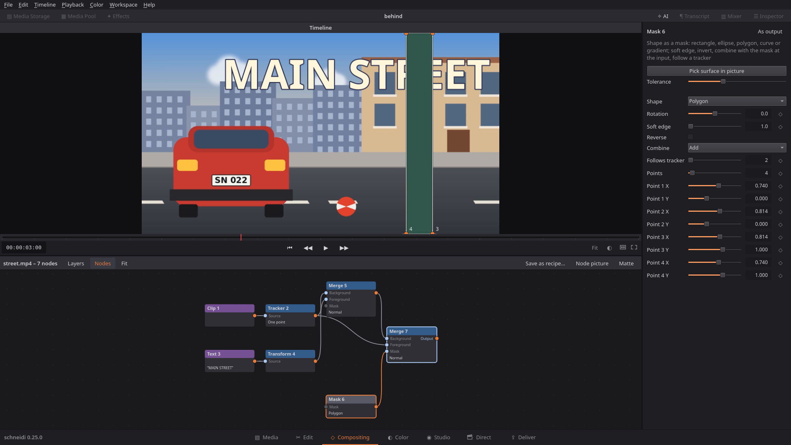
**Text behind an object** – click "Pick surface in picture" and then the wall, pillar or car: schneidi outlines it, and the title passes behind it (the mask follows a tracker when the camera moves)

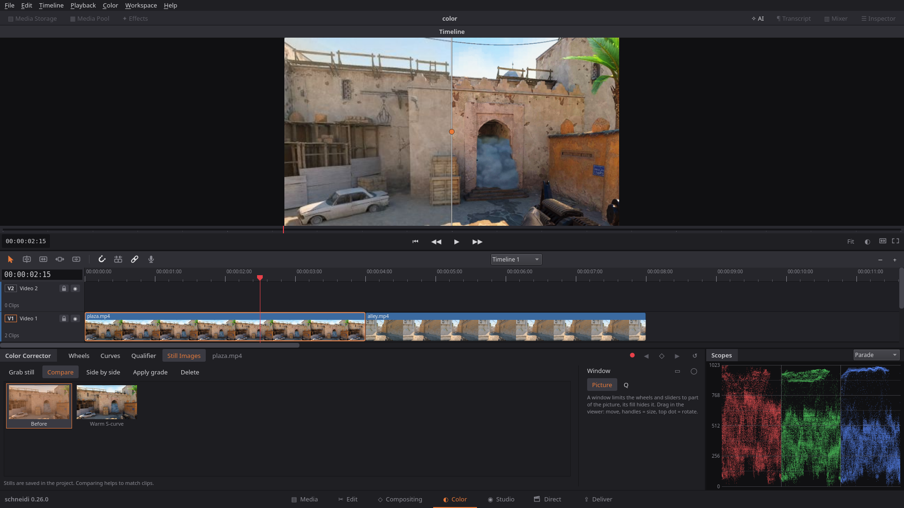
**Before and after** – keep a still of a grade and wipe across it in the viewer to see before and after (or show both side by side), then apply that grade to other clips; the deeper sky comes from the qualifier, which grades only the colors it picks


**Studio** – the mix on its own page: shape a track's level or pan with points or the pen (or ride the fader in write mode while it plays), a narrow mixer strip per track with its EQ and compressor curves a click away, and one-click tools to clean a voice, duck the music under speech or bring the whole mix to a target loudness

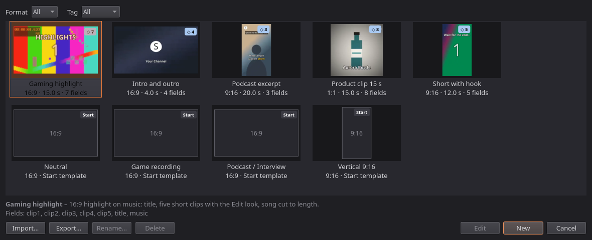
**Templates** – File › New from Template…: each template with its preview, format, length and fields; drag your clips onto the fields, or fill it from a table with `schneidi-cli template fill`

| | |
|---|---|
| [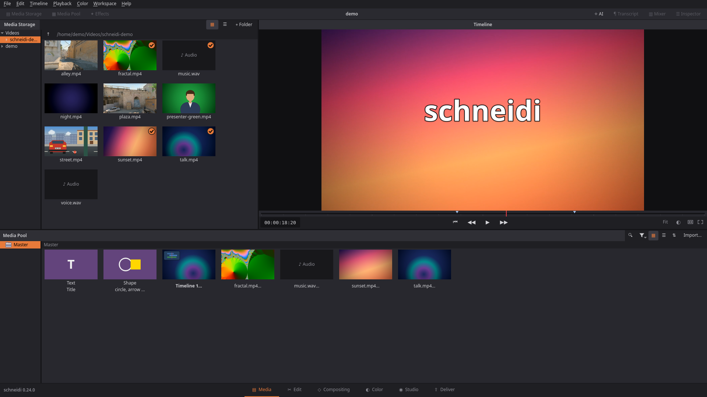](screenshots/media.png)<br>**Media** – browse and skim folders, import into the Media Pool | [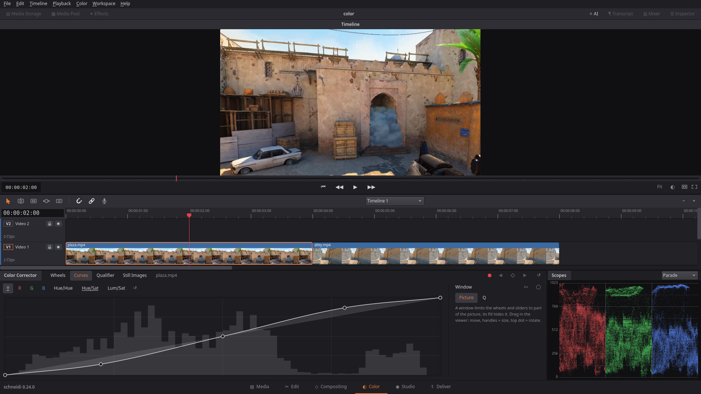](screenshots/color.png)<br>**Color** – wheels, curves, qualifier, stills, windows, LUTs, scopes |
| [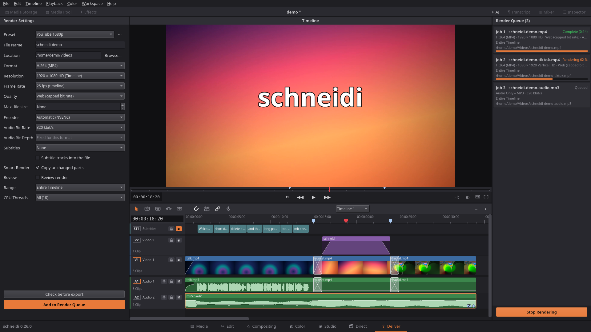](screenshots/deliver.png)<br>**Deliver** – presets and render queue | [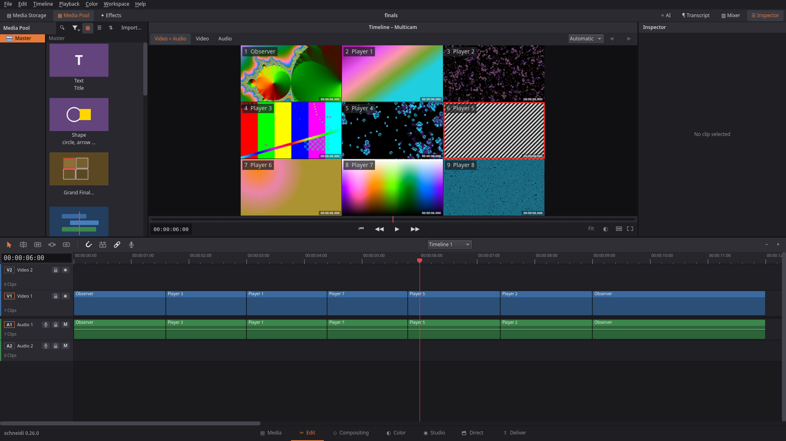](screenshots/multicam.png)<br>**Multicam** – click an angle or press 1–9 to cut to it |
| [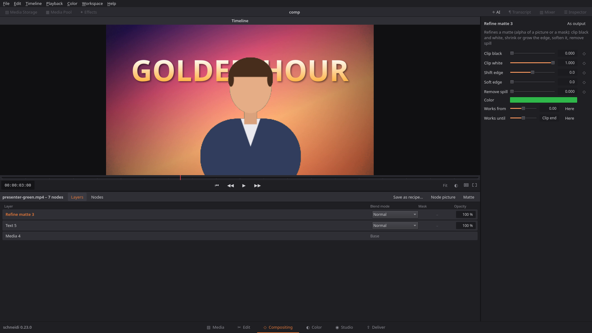](screenshots/comp-layers.png)<br>**Layers** – the same graph as a stack: blend mode, mask, opacity | [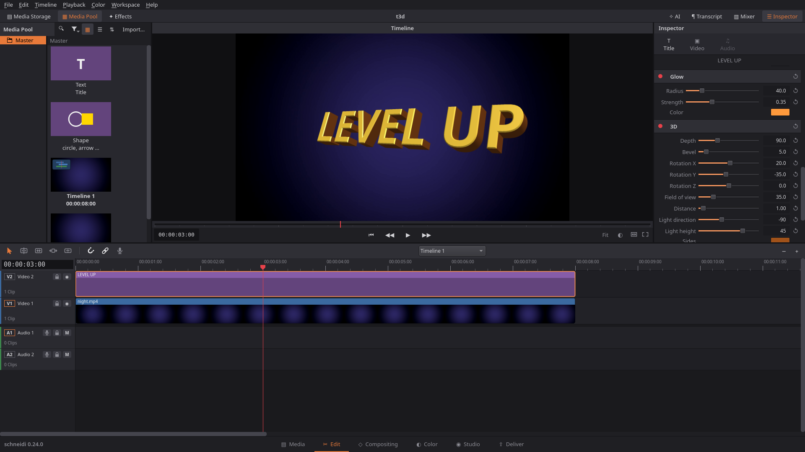](screenshots/title3d.png)<br>**3D titles** – real extruded letters with bevel, light and rotation |

## Features

The short version, one line per item. **Every detail is in [FEATURES.md](FEATURES.md).**

**Editing**
- Multi-track timeline with ripple, roll, slip and slide trims, compound clips and several timelines per project
- Multicam with up to 16 angles at once, synced by sound
- Text-based editing: delete words in the transcript to cut them
- Speed ramps and smooth slow motion with own optical flow
- An overview strip of the whole timeline above the detail view (optional)
- Timeline exchange with Premiere Pro, DaVinci Resolve and others (FCP7 XML, OpenTimelineIO, EDL)

**Direct page and shorts, templates, brand**
- Edit by recipe: a short (up to three variants), highlights of any material, a talk without pauses, a filled template, a rough cut from a script – suggestions with reasons, no chat AI needed
- A 9:16 (or 1:1, 4:5) timeline next to the 16:9 edit; auto reframe that follows the subject
- Templates with placeholders – fill them by drag and drop or from a CSV, one video per row
- Brand kit: logo, colors, fonts, intro/outro for every project
- Game footage helpers: kill feed kept readable, stretched 4:3 fixed, player names blurred (CS2)

**Compositing and titles**
- Node graph or layer stack on any clip: masks, chroma/luma keyer, recipes in one click
- Point, planar (four-corner) and face tracking; text behind an object; shapes and drawing on the video
- Titles with looks and real 3D text; word-by-word captions; your own FFmpeg filter or GLSL shader as an effect

**Color**
- Wheels with master wheels, curves, a qualifier, windows with tracking, LUTs, scopes
- Stills gallery with a before/after wipe
- HDR phone footage (HLG/PQ) shown and exported as SDR without a setting

**Sound**
- Own sample-exact audio engine; a Studio page with mixer strips, EQ, compressor and loudness readout
- Volume and pan automation with points, a pen and a write mode
- Clean Voice, ducking, loudness to a target in one click, voice-over recording, offline text to speech
- Background music of its own (hype, lo-fi, epic, funk) with a known beat grid; pauses cut where every microphone is quiet
- 5.1/7.1 projects with channel routing and a surround panner

**Export**
- H.264, H.265 (also 10-bit), AV1, VP9, ProRes, DNxHR, GIF, image sequences, audio only; hardware encoders
- Smart Render copies unchanged parts instead of encoding them again
- A check before export: gaps, missing files, loudness, unreadable subtitles, text a phone app covers
- Presets for YouTube, Shorts, Reels and TikTok

**AI and automation**
- AI chat in the app (Claude, OpenAI-compatible, Ollama), automatic or review mode
- `schneidi-cli` and an MCP server – locally, live in the open app, or over HTTP on a server
- A searchable index of your footage, highlights, beats, sync by sound, a finished short in one call

## How mature is it?

schneidi is young (first commit at the end of September 2026) and written by one person with an AI assistant. Breadth
came fast, so here is an honest map. **Stable** = many releases old, used for real edits, covered by tests. **Young** =
tested, but newer or with little real-world use, and with known gaps. **Experimental** = works, but expect rough
edges; never a default.

| Area | Since | Maturity | Known limits |
|---|---|---|---|
| Timeline editing, trims, undo, project files | 0.1 | stable | The project file format may still change before 1.0 (old projects are converted) |
| Playback, proxies, render cache, export (own picture engine) | 0.15 | stable | 8K60 without proxies is not smooth |
| Sound engine, mixer, loudness, Clean Voice | 0.10 | stable | |
| Command line and MCP, live editing in the app | 0.6 / 0.7 | stable | |
| AI chat in the app | 0.12 | stable | A local model needs a 32k context; small local models make more mistakes than Claude |
| Multicam, sync by sound | 0.8 | stable | Tested with game recordings and synthetic material, not with a real multi-camera shoot |
| Shorts, auto reframe, captions, `short` | 0.16 | stable | Highlights know kills only in CS2 and Valorant; other footage gets "loud moments" |
| Direct page, `direct`, `cut_pauses` | 0.25 | young | Moments come from the sound, picture changes and kill feeds – it does not see what is in the picture; filler words only as far as the transcript has them |
| Music bed (own background music) | 0.25 | young | Simple synth music for under the program sound; four moods |
| Blur player names | 0.16 | young | CS2 only in practice: a Valorant template exists but is less tested; small name tags in the 3D picture are often missed – always check the result |
| Templates, brand kit | 0.18 | stable | |
| Compositing, keying, masks, recipes | 0.19 | young | |
| Tracking (planar, text behind an object, camera) | 0.22 | young | A fast-moving or blurred surface loses the track (it then fades out or holds) |
| 3D titles, title looks | 0.19 | young | |
| AI cutout, own FFmpeg filter / GLSL effects | 0.19 | experimental | The cutout is an optional extension; a GLSL effect needs an installed `qsb` |
| Studio page, automation | 0.23 | young | |
| 5.1/7.1 surround | 0.23 | young | Checked with meters and test files, little real-world use yet |
| Curves, qualifier, stills, master wheel | 0.24 | young | No curve keyframes; the qualifier has no spatial mask smoothing; with a qualifier or hue curves active a fine 65-point LUT is resampled to 33 points |
| HDR → SDR, 10-bit export | 0.24 | young | PQ above 1000 nits goes to white; Dolby Vision only through its HLG/HDR10 base; no HDR export yet; VAAPI/Quick Sync 10-bit not checked on real hardware |
| **s264** (own H.264 encoder) | 0.24 | experimental | In two-pass faster than x264 medium on game, calm and animation footage, slower on camera footage and in CRF mode; never the default, x264 stays the encoder to use |
| Windows build | 0.5 | young | No download yet, build it yourself; tested less than Linux and not in CI |
| Translations | 0.6 – 0.21 | young | Most languages beyond English and German are translated by AI |

**Tests:** about 250 test programs (editing, file formats, sound, picture on CPU and GPU, CLI, widgets) on synthetic
footage, run by [CI](.github/workflows/ci.yml) on every push to main on Debian 13 – once with and once without the
GPU picture path. Fuzzers for project files, subtitles, timeline exchange and the MCP/HTTP server run by hand
(`tests/fuzz`). Before each release the whole suite runs and an AI review reads the changes; speed is tracked in
[BENCHMARKS.md](BENCHMARKS.md), including the runs that got worse. What the tests do not prove: that every
combination of features looks right on your material – [issues](https://github.com/OnkelTheorie/schneidi/issues)
with a sample file help most.

## How light is it?

<!-- The figures in the tables below feed site/figures.json (the project website): after changing one, run tools/site_figures.py --write (ctest site_figures checks it). -->

> **Measured with older versions:** the two tables below are from **0.11** (Ryzen 5 5600X) and **0.13** (Ryzen 5 PRO 2400G) and have not been measured again since. The picture engine was rewritten in 0.15, and features were added after that; newer numbers from the regular benchmark runs are in [BENCHMARKS.md](BENCHMARKS.md).

Measured on two desktop CPUs restricted with Linux cgroups (cores, RAM, no swap) – stand-ins for old hardware, not a real old laptop: a Ryzen 5 5600X (with 0.11) and a Ryzen 5 PRO 2400G (2018, 4 cores, built-in Vega graphics; with 0.13). Each cell: **5600X / 2400G**.

**Starting (0.11 / 0.13):**

| 5600X / 2400G | Empty project | Project with a 1080p clip |
|---|---|---|
| Least RAM it starts and keeps running with | 128 / 112 MB | 288 / 288 MB |
| Window visible, one full core | 0.6 / 0.7 s | 0.5 / 0.8 s |
| Window visible, 10 % of one core | 6 / 11 s | 6 / 12 s |
| Window visible, 5 % of one core | 11 / 25 s | 15 / 25 s |

RAM in steps of 16 MB (the 2400G was measured in a Docker container, the 5600X in a systemd scope). Thumbnails for the Media Storage (your Videos folder) are made by a separate ffmpeg at the start; for a large file that takes up to ~100 MB more for a moment.

**But starting is not the same as editing smoothly.** Playback (0.11 / 0.13) of a demanding project (12 gaming clips, 1080p60 at 140 Mbit/s, a grade on every clip), frames per second out of 60 over 15 s, the start-up included – from about 52 on it plays a steady 60 after the first second or two:

| CPU (5600X / 2400G) | From the original files | Originals, decoded on the graphics card | From proxies |
|---|---|---|---|
| 1 core | 12 / 11 – stutters | 55 / 53 | 57 / 53 |
| 2 cores | 44 / 16 – stutters on the 2400G | 59 / 54 – smooth | 57 / 57 |
| 4 cores | 57 / 53 – smooth | | |
| All cores (6 / 4 with SMT) | 58 / 57 – smooth | | |

0.10 managed 3.6 frames/s on one core and 9 on two: 0.11 decodes the video itself. Decoding on the graphics card (NVIDIA, AMD/Intel via VA-API; here a GTX 1070 and the 2400G's built-in Vega 11) is on by default – with it one core is enough even on the 2400G. On a computer too slow for the originals, schneidi notices it during playback and offers to generate proxy media (also by hand: right-click a clip in the Media Pool › Generate Proxy Media). Playback › Clean Up Proxy Media… lists the proxy files no open or recent project needs (original deleted or changed, project gone) and frees their space. A few seconds after playback stops or an export ends, schneidi gives the memory it no longer needs back to the system (after a 1080p export about 1450 → 590 MB).

**And on real weak hardware: a Raspberry Pi Zero 2 W** (4 × 1 GHz Cortex-A53, 512 MB RAM, Debian 13 ARM64, no hardware decoding; built from source, there is no ARM download yet; measured with the 0.25 development build of 2026-11-19). DaVinci Resolve, Premiere Pro and Final Cut Pro are not available for this computer at all. Material: 15 s of a 1080p60 gaming clip.

| | Raspberry Pi Zero 2 W |
|---|---|
| Window visible | 1.7 s, 102 MB RAM (about 230 MB with a 720p clip) |
| Playback 720p30 original | 29 of 30 frames/s, sound in sync |
| Playback 1080p60 original | 2 to 3 frames/s – the Pi cannot even decode it in real time |
| Playback 1080p60 from proxies | 59 of 60 frames/s over 10 s – a steady 60 from the second second on, sound in sync |
| Jumping in the timeline, original → proxies | 2.6 s → 0.05 s |
| Export 5 s of 720p (x264 / own s264) | 56 s / 74 s |

## Performance

Measured, not estimated: the large 1080x1920 test project (27 clips, about 60 titles) renders in about 37 s with 1.5 GB of RAM since 0.15.0 (0.14.1: 59 s, 4.3 GB), an empty project starts in about 0.4 s, and a Raspberry Pi Zero 2 W with 415 MB of RAM opens the window in under 2 s. 8K footage is editable with proxies; 8K60 without proxies is not smooth. Every benchmark run on record, including the ones that got worse, is in [BENCHMARKS.md](BENCHMARKS.md).

## AI chat in the app

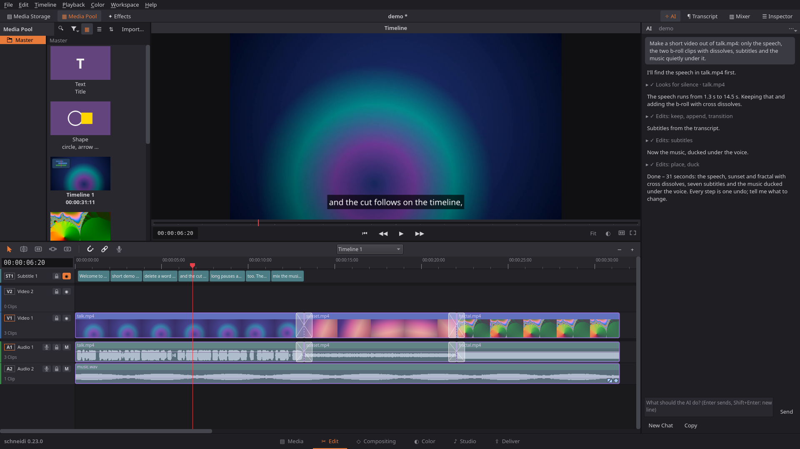

Click **✧ AI** in the top bar and tell an AI what to do in the open project – "remove every pause longer than a
second", "put the subtitles on and make them bigger", "cut the clips to the beat of the song". It uses the same tools
as every other AI ([below](#command-line-and-ai-editing-mcp)), looks at frames, measures the sound and works while
you watch: changed clips light up, each change is an undo step. In **review mode** (File › Settings › AI) the changes of a
request show in the timeline and preview first; then **Accept** keeps them as one undo step and **Discard** puts the
project back.

- **Providers:** Claude (Anthropic), OpenAI, OpenRouter, Ollama on your computer, or any address that speaks the
  OpenAI chat API (LM Studio, vLLM, Mistral, Groq, a company proxy …). The model name is free to change. A local model
  needs a context of about 32k tokens for the tools and the editing guide (Ollama: `OLLAMA_CONTEXT_LENGTH=32768`).
- **Keys:** from the environment (`SCHNEIDI_AI_KEY`, or `ANTHROPIC_API_KEY` / `OPENAI_API_KEY` / `OPENROUTER_API_KEY`
  for that provider only), else from the system keychain (Secret Service, Windows Credential Manager). Keys never go
  into logs or the chat.
- **For companies:** a `schneidi-ai.json` in `/etc/xdg/schneidi` or `~/.config/schneidi` (Windows:
  `C:\ProgramData\schneidi\schneidi`) sets `provider`, `address`, `model` and `key` or `key_file`;
  `"locked": true` keeps users on that provider.
- **Privacy:** before the first message to a cloud provider schneidi says once what goes there (project contents,
  frames, transcripts). The chat history stays in memory only. The panel shows the tokens of the chat.

## Command line and AI editing (MCP)

`schneidi-cli` edits the same project files without a window, for scripts and AI assistants. A typical rough cut:
let the AI find the pauses, keep the rest, look at the result, render, then fine-tune in schneidi.

```bash
schneidi-cli new talk.schneidi --fps 25 --media talk.mp4
schneidi-cli overview talk.mp4                               # first look: loudness, silence, motion, cuts per stretch
schneidi-cli silence talk.mp4 --project talk.schneidi        # "sound" ranges without the pauses
schneidi-cli scenes broll.mp4 --project talk.schneidi        # shot changes
schneidi-cli scenes game.mp4 --region 0.75,0.05,0.25,0.3     # events in a part of the picture (kill feed)
schneidi-cli peaks game.mp4 --top 10                         # the loudest moments
schneidi-cli beats song.mp3 --project talk.schneidi          # tempo, bars, phrases, breaks and drops of a song
schneidi-cli highlights game.mp4 --region 0.70,0.04,0.22,0.23 --color "#e7e371"  # own kills (Valorant), best first
schneidi-cli sync cam1.mp4 cam2.mp4 cam3.mp4                 # offsets of recordings of the same event
schneidi-cli short game1.mp4 game2.mp4 --for tiktok          # best moments → reframed 9:16 short with captions, checked, rendered
schneidi-cli direct clip1.mp4 clip2.mp4 --recipe highlights   # suggestions with reasons; then: direct --session <id> --apply '{"on":"all"}'
schneidi-cli templates                                       # start and content templates; `template info short-hook`: its fields
schneidi-cli template fill short-hook --values '{"hook":"Wait for it","clip1":"/clips/a.mp4"}' --out_project short.schneidi --render '{}'
schneidi-cli brand --action set --colors "#ffcc00,#202020" --fonts Inter --logo logo.png   # your brand kit
schneidi-cli extensions --install whisper,small              # optional speech recognition (download, ~200 MB)
schneidi-cli transcribe talk.mp4 --language de --words       # what is said, with word times
schneidi-cli edit talk.schneidi --ops '[{"op":"keep","media":"talk.mp4","ranges":[[0,250],[310,900]]}]'
schneidi-cli edit talk.schneidi --ops '[{"op":"comp","clips":[4],"recipe":"greenscreen","with":{"background":"beach.jpg"}}]'
schneidi-cli frames talk.schneidi --clip 4 --node 2 --view matte --out key.jpg   # is the key clean?
schneidi-cli frames talk.schneidi --count 9 --sheet --out sheet.jpg
schneidi-cli scopes talk.schneidi --at 10s --out scopes.png      # waveform, parade, vectorscope + numbers
schneidi-cli loudness talk.schneidi                          # LUFS, true peak of the mix
schneidi-cli edit talk.schneidi --ops '[{"op":"track_volume","track":"A2","points":[["10s",0],["12s",-12]]}]'   # music down at 12 s
schneidi-cli check talk.schneidi                             # before export: gaps, missing media, subtitles, sound
schneidi-cli render talk.schneidi --out talk-cut.mp4 --preset "YouTube 1080p"
schneidi-cli export_timeline talk.schneidi --out talk.xml       # for Premiere / DaVinci (also .otio, .edl)
schneidi-cli import talk.schneidi --timeline_file premiere.xml   # a cut from Premiere / DaVinci as a new timeline
schneidi-cli restore talk.schneidi                           # undo the last change (file mode)
schneidi-cli help                                            # the commands in short (JSON)
schneidi-cli help render                                     # all parameters of one command
schneidi-cli help edit                                       # every edit operation, what it is for
schneidi-cli help edit --op speed_ramp                       # the details of one edit operation
```

Edit operations cover cutting, inserting and source edits (insert, replace, place on top, fit to fill), moving,
trimming (ripple, roll, slip, slide), titles with their style, fades, transitions (dissolve, dip, wipes, luma),
speed and speed ramps (with in-between frames), markers, subtitles (SRT or cue lists, track styles) and word captions, effects and presets, the color grade
(wheels, LUTs, windows with blur/pixelate and tracking), transform and crop, reframe to another shape, black bars and stretched 4:3, blurring player names, keyframes for any animatable value, paste attributes, volume/pan, the mixer
(also to a loudness target, EQ and compressor per track, a surround panner), track volume and pan automation (`track_volume`, `track_pan`), 5.1/7.1 projects and channel routing (`format channels`, `route`), ducking, background music of its own (`music_bed`), cutting the pauses of a conversation (`cut_pauses`), loudness normalization, voice cleaning, text to speech, tracks, linking, compound
clips, compositing graphs (`comp` with recipes, `comp_from`, `node`, trackers with `track_node`, AI cutouts with `cutout_node`), template placeholders (mark, fill), multicam clips (create, cut to an angle, change angles, flatten), several timelines (each with its own format) and the project format. Positions can be given relative to a clip or to the source material (`{"clip": 12, "source":
"34.2s"}`), so they stay right while earlier operations move clips. Output is JSON on stdout (exit code 0 = ok,
1 = error, 2 = usage error); every save keeps a backup of the previous state (`backups`, `restore`). `schneidi-cli mcp` runs the same commands as an [MCP](https://modelcontextprotocol.io) server on stdio.

**Connect Claude, Cursor or another MCP client:** `schneidi-cli setup claude`, or by hand – see
[Use with AI (MCP)](#use-with-ai-mcp).

**Live with the app:** if the project is open in schneidi, every command works on what the app shows (unsaved
changes included). An `edit` changes the open project as one undo step and does not save; `info` adds the playhead
and the selection; `app` plays, seeks, selects, undoes, saves, generates proxies and cleans up old ones. The app shows "AI connected"
while a session is active, lights up the clips it changed and has a button to disconnect it. `@app` as the project
means the project of the running app. Without the app (or on a server) the CLI works on the file as before.

```bash
schneidi-cli app state                                       # playhead, selection, open timeline
schneidi-cli edit @app --ops '[{"op":"split","at":"12s"}]'   # cut in the open project
schneidi-cli app undo
```
The AppImage contains the CLI too: `./schneidi-<version>-x86_64.AppImage cli help`, or a link to the AppImage named `schneidi-cli`.

**On a server (HTTP, Docker):** `schneidi-cli serve` runs the same tools as an MCP server over HTTP, so AIs on other
devices and fully automatic pipelines can edit on a server: material goes in by `PUT /files/…` or the `upload` tool,
results come back as download links, long renders turn into jobs (`jobs`), and nothing outside the work folder
(`--root`) can be read or written. It listens on localhost by default; on the network or behind a reverse proxy (`--public-url`) a token is required. A Docker
image (`ghcr.io/onkeltheorie/schneidi`, from 0.12.0) with compose file is in [packaging/docker](packaging/docker/README.md).

```bash
schneidi-cli serve --root ~/videos                            # http://127.0.0.1:8642/mcp
claude mcp add --transport http schneidi http://127.0.0.1:8642/mcp
```

## Roadmap

What comes next. Plans can still change, and there are no dates. What earlier versions brought is in the
[release notes](https://github.com/OnkelTheorie/schneidi/releases).

### Next: 0.26 – Touch Update
Editing with touch input (a tablet or a touch screen), s264 using what the editor already knows about the picture
(cuts, still parts, motion), and fixes from tests with real use.

### Ideas for later (no order, not promised)
- Color management (a working color space per project) and HDR export
- Camera RAW, starting with DNG
- s264 faster and ready to be more than an experiment
- A Windows download and installer for 1.0

## Building

C++20, Qt 6 Widgets, FFmpeg libraries (own picture and audio engine), CMake.

**Linux (Debian/Ubuntu):**

```bash
sudo apt install build-essential cmake ninja-build pkg-config qt6-base-dev qt6-base-private-dev libavformat-dev libavcodec-dev libswresample-dev libswscale-dev libavutil-dev libminiaudio-dev
cmake -S . -B build -G Ninja && cmake --build build && ./build/schneidi
```

Optional: `libavfilter-dev` (effect "FFmpeg filter": a filter chain on a clip) and `qt6-shader-baker` (effect "Shader": own GLSL effects, compiled at run time by its `qsb` program; GPL-3, so the AppImage/Windows packages do not bundle it - an installed one is found). Without them those two effects say they are not available; everything else works.

Other distributions: the same libraries (Qt 6 Widgets/Network and its private GUI headers, FFmpeg 7). Without a miniaudio package (openSUSE, Fedora) the build uses the copy in `third_party/miniaudio` (`-DSCHNEIDI_SYSTEM_MINIAUDIO=ON` insists on the system's). Notes for distribution packagers and an openSUSE spec file: [packaging/linux/opensuse](packaging/linux/opensuse).

AppImage: `packaging/linux/build-appimage.sh` → `dist/schneidi-<version>-x86_64.AppImage` with an own slim FFmpeg including x264/x265 (GPL; build packages `libx264-dev libx265-dev`); `GPL_ENCODERS=0` builds a GPL-free one instead (`…-lgpl.AppImage`: OpenH264/kvazaar, x264/x265 as an optional download in the program); bundled libraries and their licenses: [THIRD_PARTY.md](THIRD_PARTY.md)
Debian package (system Qt/FFmpeg, no bundling): `cmake --build build && cpack --config build/CPackConfig.cmake -G DEB` → `dist/schneidi_<version>_amd64.deb`
The .deb is built for Debian 13: it needs exactly its Qt 6.8.2 (the GPU viewer uses Qt's private RHI interface) and FFmpeg 7.1; on every other system use the AppImage.
Arch Linux package: `packaging/linux/arch/PKGBUILD` (`makepkg -si`, against Arch's own Qt and FFmpeg; [packaging/linux/arch](packaging/linux/arch/README.md)); each release has the built `schneidi-<version>-1-x86_64.pkg.tar.zst` (`sudo pacman -U …`), which needs a rebuild after an Arch Qt update.

**Windows:** via [MSYS2](https://www.msys2.org), UCRT64 environment. Clone the repo into a path without spaces or non-ASCII characters, then:

```bash
pacman -S --needed mingw-w64-ucrt-x86_64-{toolchain,cmake,ninja,pkgconf,qt6-base,qt6-svg,ntldd,miniaudio}
pacman -S --needed nasm make diffutils mingw-w64-ucrt-x86_64-{openh264,kvazaar,svt-av1,libvpx,dav1d,opus,lame,libvpl,libx264,x265}
packaging/windows/build-windows.sh
```

Result: `dist/schneidi-windows-<version>.zip` (portable folder) and, if [Inno Setup 6](https://jrsoftware.org/isinfo.php) is installed (`winget install JRSoftware.InnoSetup`), `dist/schneidi-setup-<version>.exe`. Like the AppImage: the first run builds the own slim FFmpeg with x264/x265 (`packaging/windows/build-ffmpeg-lgpl.sh`, into `build-ffmpeg/prefix` or `FFMPEG_PREFIX`). `GPL_ENCODERS=0` builds without any GPL library (`build-ffmpeg-lgpl/prefix`, `…-lgpl.zip`; the installer then offers x264/x265 as an optional download).

**Tests:**

```bash
cmake -S . -B build-tests -G Ninja -DSCHNEIDI_TESTS=ON && cmake --build build-tests && ctest --test-dir build-tests --output-on-failure
```

## Credits

Developed by [OnkelTheorie](https://github.com/OnkelTheorie) with the help of [Claude](https://claude.ai) (Anthropic) as an AI coding assistant.

Sponsored by [@ZenITDigital](https://github.com/ZenITDigital), who pays for the Claude Max plan behind schneidi's development – thank you so much!

## Disclaimer

schneidi is an independent open-source project. It is not affiliated with, endorsed by or sponsored by Blackmagic Design. DaVinci Resolve is a trademark of Blackmagic Design Pty Ltd and is mentioned here for descriptive purposes only.

## License

[AGPL-3.0-only](LICENSE): use schneidi for anything, change it, share it. If you publish a changed version, or offer it to others as an online service, publish your source code too. Versions up to 0.12 are GPL-3.0.

The schneidi released here has no ads, no subscriptions and no telemetry. From 0.14 on the license is plain AGPL-3.0-only: the app store permission that 0.13 carried (linking a store's ad, purchase or license check libraries) is gone. It still applies to the 0.13 versions released with it.

The code is open; the name "schneidi" and the logo are protected, see [TRADEMARKS.md](TRADEMARKS.md). Want to contribute? See [CONTRIBUTING.md](CONTRIBUTING.md).
