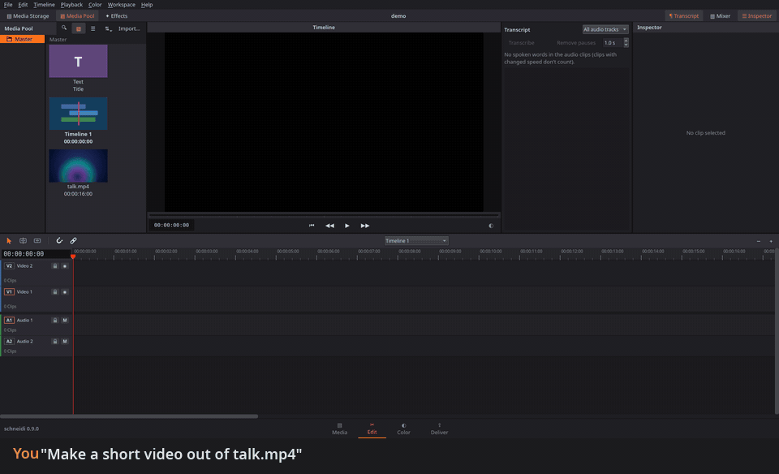
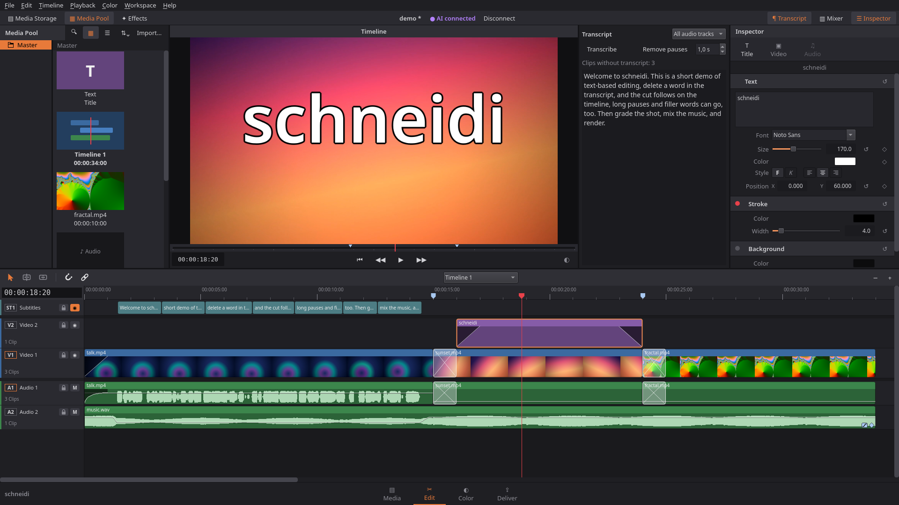
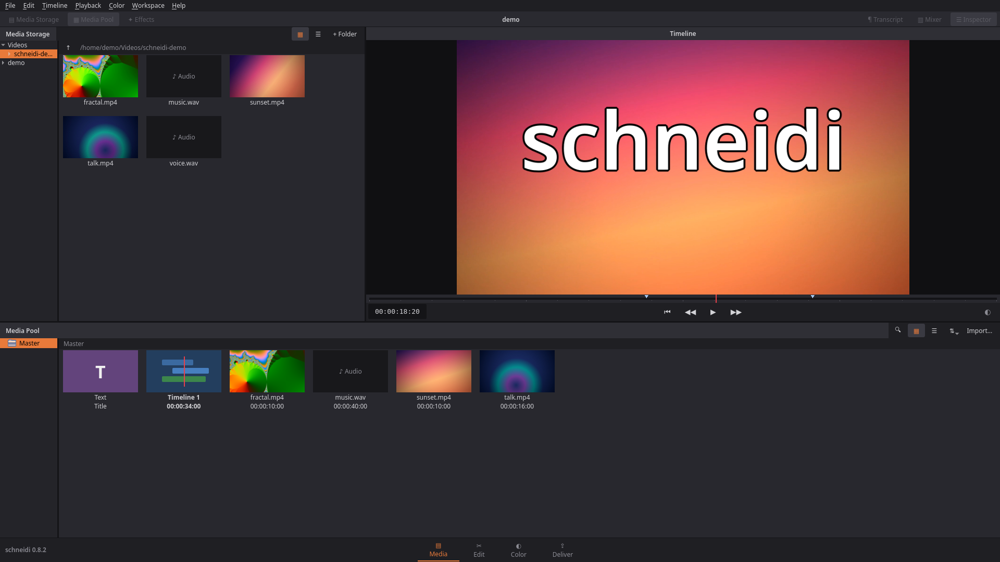
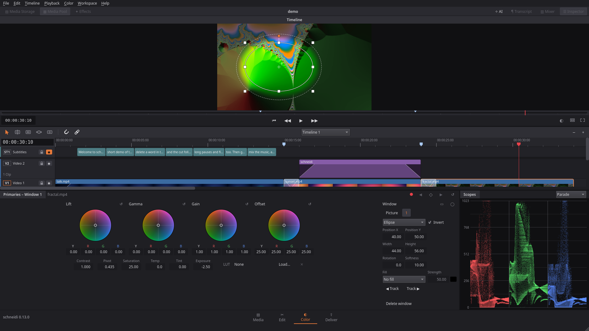
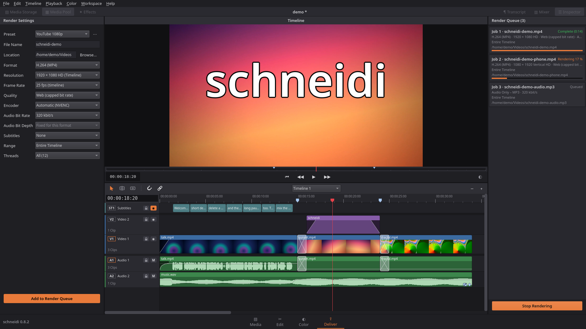
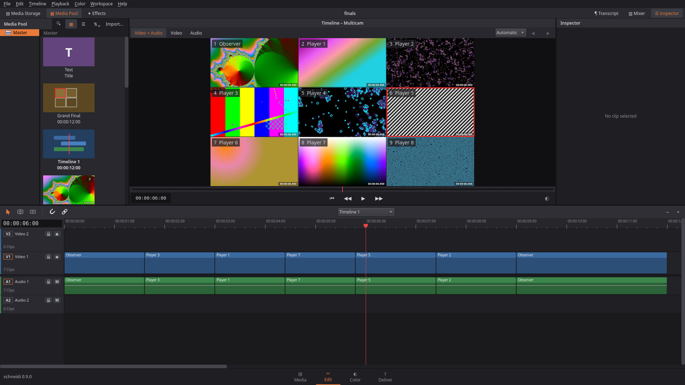

# schneidi

**A DaVinci-style video editor that an AI assistant can edit with you – live, in the project you have open.**

schneidi has Media, Edit, Color and Deliver pages like DaVinci Resolve, with far fewer features. It runs on modest hardware and opens H.264/H.265 video with AAC sound on Linux, which the free DaVinci Resolve does not. The UI is available in English, German, Spanish, French, Polish and Russian.

[](https://github.com/OnkelTheorie/schneidi/releases/latest)

**[Download the latest release](https://github.com/OnkelTheorie/schneidi/releases/latest)** (Linux AppImage or Debian package). Windows: no download yet – [build it yourself](#building); an installer is planned for 1.0.

> Status: early development (0.x). The project file format may still change between versions.



## Why schneidi?

- **Edit together with an AI.** schneidi comes with its own command line and [MCP server](#command-line-and-ai-editing-mcp). Claude or another assistant can find pauses, scene changes and loud moments, transcribe, cut, grade, mix and render. When the project is open in the app, each change lands there as one undo step while you watch ("AI connected") – review it, undo it or disconnect.
- **DaVinci's workflow without its hurdles.** The same pages and terms (ripple, roll, slip, slide, compound clips) and many of the same shortcuts (`=`/`-` to copy grades, `1`–`9` to cut multicam angles), but light enough for an older laptop.
- **Everything stays on your computer.** Speech recognition (whisper.cpp), text-based editing, sync by sound and rendering work offline – no account, no cloud, open source (GPL-3.0).
- **Long recordings of one event.** Sync hours of recordings from several PCs or cameras by their sound and cut them in a multicam view that shows up to 16 angles at once.

## Screenshots



| | |
|---|---|
| [](screenshots/media.png)<br>**Media** – browse folders, import into the Media Pool | [](screenshots/color.png)<br>**Color** – color wheels, LUTs, scopes |
| [](screenshots/deliver.png)<br>**Deliver** – presets and render queue | [](screenshots/multicam.png)<br>**Multicam** – click an angle or press 1–9 to cut to it |

## Features

- Multiple video and audio tracks: cut, trim, move, snapping, undo/redo
- **Multicam:** a multicam clip from several recordings of one event, synced by sound, markers, In points or start; the viewer shows up to 16 angles at once (more on pages) – click or press 1–9 to cut, change angles later, flatten to normal clips
- Timeline zoom and scroll change **only on user input** – nothing jumps when clips get shorter
- Fully customizable keyboard shortcuts
- Titles, subtitles, fades, transitions, volume, loudness normalization
- Color correction, curves, LUTs, effects with keyframes; copy and paste grades (`=`/`-` like DaVinci)
- Video stabilization (vid.stab) and audio noise reduction
- frei0r effects; import effect presets from Kdenlive and Shotcut
- Video scopes: waveform, RGB parade, vectorscope, histogram
- Two-up/four-up trim view while dragging an edit
- Loudness and true-peak meters, master limiter that holds a true-peak ceiling
- Per-track EQ (6 bands) and compressor in the mixer, ducking (music goes down while someone speaks)
- Files with several audio streams (OBS): import presets per stream title – mute the mix, leave out streams, name the tracks
- Clip speed / retime
- Proxy and render cache for smooth playback
- Export and render queue via FFmpeg: H.264, H.265, AV1, VP9 (WebM), ProRes and DNxHR, animated GIF, PNG/TIFF/JPEG image sequences and audio only (AAC, MP3, Opus, WAV, AIFF, FLAC, Apple Lossless); hardware encoders (NVENC, VAAPI, Quick Sync) when available; YouTube/phone presets cap the bit rate
- Subtitles from speech (whisper.cpp, offline) – pick the voice tracks, one subtitle track each; an optional download under Workspace → Extensions
- Text-based editing: the Transcript panel shows what is said – delete words to cut them, remove pauses
- **Command line and MCP server** (`schneidi-cli`): scripts or an AI assistant can edit almost everything the app can – find pauses, scene changes, loud moments and events in a part of the picture (kill feed, score), sync recordings by their sound, build multicam clips, transcribe, cut and trim, grade, animate, mix, duck music and normalize, measure loudness, look at frames (or a detail of them) and scopes, render ([details](#command-line-and-ai-editing-mcp))
- Themes, six UI languages (English, German, Spanish, French, Polish, Russian)

## Command line and AI editing (MCP)

`schneidi-cli` edits the same project files without a window, for scripts and AI assistants. A typical rough cut:
let the AI find the pauses, keep the rest, look at the result, render, then fine-tune in schneidi.

```bash
schneidi-cli new talk.schneidi --fps 25 --media talk.mp4
schneidi-cli silence talk.mp4 --project talk.schneidi        # "sound" ranges without the pauses
schneidi-cli scenes broll.mp4 --project talk.schneidi        # shot changes
schneidi-cli scenes game.mp4 --region 0.75,0.05,0.25,0.3     # events in a part of the picture (kill feed)
schneidi-cli peaks game.mp4 --top 10                         # the loudest moments
schneidi-cli sync cam1.mp4 cam2.mp4 cam3.mp4                 # offsets of recordings of the same event
schneidi-cli extensions --install whisper,small              # optional speech recognition (download, ~200 MB)
schneidi-cli transcribe talk.mp4 --language de --words       # what is said, with word times
schneidi-cli edit talk.schneidi --ops '[{"op":"keep","media":"talk.mp4","ranges":[[0,250],[310,900]]}]'
schneidi-cli frames talk.schneidi --count 9 --sheet --out sheet.jpg
schneidi-cli scopes talk.schneidi --at 10s --out scopes.png      # waveform, parade, vectorscope + numbers
schneidi-cli loudness talk.schneidi                          # LUFS, true peak of the mix
schneidi-cli render talk.schneidi --out talk-cut.mp4 --preset "YouTube 1080p"
schneidi-cli restore talk.schneidi                           # undo the last change (file mode)
schneidi-cli help                                            # all commands (JSON)
schneidi-cli help edit                                       # every edit operation with details
schneidi-cli help edit --op speed_ramp                       # one edit operation
```

Edit operations cover cutting, inserting and source edits (insert, replace, place on top, fit to fill), moving,
trimming (ripple, roll, slip, slide), titles with their style, fades, transitions (dissolve, dip, wipes, luma),
speed and speed ramps, markers, subtitles (SRT or cue lists, track styles), effects and presets, the color grade
(wheels, LUTs), transform and crop, keyframes for any animatable value, paste attributes, volume/pan, the mixer
(also to a loudness target, EQ and compressor per track), ducking, loudness normalization, tracks, linking, compound
clips, multicam clips (create, cut to an angle, change angles, flatten), several timelines and the project format. Positions can be given relative to a clip or to the source material (`{"clip": 12, "source":
"34.2s"}`), so they stay right while earlier operations move clips. Output is JSON on stdout (exit code 0 = ok,
1 = error, 2 = usage error); every save keeps a backup of the previous state (`backups`, `restore`). `schneidi-cli mcp` runs the same commands as an [MCP](https://modelcontextprotocol.io) server on stdio, e.g. for
Claude Code: `claude mcp add --scope user schneidi -- schneidi-cli mcp` (`--scope user`: in every folder, not only
the one where you ran it), or in Claude Desktop's `claude_desktop_config.json`:

```json
{ "mcpServers": { "schneidi": { "command": "/path/to/schneidi-cli", "args": ["mcp"] } } }
```

**Live with the app:** if the project is open in schneidi, every command works on what the app shows (unsaved
changes included). An `edit` changes the open project as one undo step and does not save; `info` adds the playhead
and the selection; `app` plays, seeks, selects, undoes, saves and generates proxies. The app shows "AI connected"
while a session is active, lights up the clips it changed and has a button to disconnect it. `@app` as the project
means the project of the running app. Without the app (or on a server) the CLI works on the file as before.

```bash
schneidi-cli app state                                       # playhead, selection, open timeline
schneidi-cli edit @app --ops '[{"op":"split","at":"12s"}]'   # cut in the open project
schneidi-cli app undo
```
The AppImage contains the CLI too: `./schneidi-<version>-x86_64.AppImage cli help`, or a link to the AppImage named `schneidi-cli`.

## Roadmap

What we are working on next. Plans can still change; the order within a version is not fixed.

### 0.8.x – bug fixes
Only fixes for problems found in 0.8.0 – new features wait for the next version.

### 0.9 – Masks & workspace
| Feature | What it does |
|---|---|
| **Shape masks** | Shapes such as a rectangle or an ellipse on the Color page: grade only part of the picture |
| **Blur or cover a region** | Hide a face, a name, a phone number or an overlay (built on the masks) |
| **Motion tracking** | A mask follows a moving object, so the blur stays where it belongs |
| **Keyboard and layout presets** | Load a whole set of shortcuts at once, a simpler "beginner" layout, remember panel sizes per page |

### 0.10 – Analysis & handoff
| Feature | What it does |
|---|---|
| **Highlight finder for AI editing** | `peaks` groups loud moments into fights, finds a kill sound from one example, `scenes` spots new kill-feed entries by color and size, and every candidate gets a score – ready to hand to `keep` |
| **Contact sheets** | `frames`: choose the number of columns and the tile size, crop each source separately |
| **EDL / XML export** | Hand a finished cut over to other editors for finishing |
| **Voiceover** | Record your voice straight onto a track while the timeline plays |

## Building

C++20, Qt 6 Widgets, MLT 7, CMake.

**Linux (Debian/Ubuntu):**

```bash
sudo apt install build-essential cmake ninja-build pkg-config qt6-base-dev libmlt++-dev libmlt-dev
cmake -S . -B build -G Ninja && cmake --build build && ./build/schneidi
```

AppImage: `packaging/linux/build-appimage.sh` → `dist/schneidi-<version>-x86_64.AppImage`
Debian package (system Qt/MLT, no bundling): `cmake --build build && cpack --config build/CPackConfig.cmake -G DEB` → `dist/schneidi_<version>_amd64.deb`
The .deb needs Debian 13 / Ubuntu 25.04 or newer (MLT ≥ 7.30, Qt ≥ 6.8, libc6 ≥ 2.38, libstdc++6 ≥ 14); on older systems use the AppImage.

**Windows:** via [MSYS2](https://www.msys2.org), UCRT64 environment. Clone the repo into a path without spaces or non-ASCII characters, then:

```bash
pacman -S --needed mingw-w64-ucrt-x86_64-{toolchain,cmake,ninja,pkgconf,qt6-base,qt6-svg,mlt,ffmpeg,frei0r-plugins,SDL2,ntldd,libebur128,fftw,libsamplerate,rubberband,rtaudio}
packaging/windows/build-windows.sh
```

Result: `dist/schneidi-windows-<version>.zip` (portable folder) and, if [Inno Setup 6](https://jrsoftware.org/isinfo.php) is installed (`winget install JRSoftware.InnoSetup`), `dist/schneidi-setup-<version>.exe`.

**Tests:**

```bash
cmake -S . -B build-tests -G Ninja -DSCHNEIDI_TESTS=ON && cmake --build build-tests && ctest --test-dir build-tests --output-on-failure
```

## Credits

Developed by [OnkelTheorie](https://github.com/OnkelTheorie) with the help of [Claude](https://claude.ai) (Anthropic) as an AI coding assistant.

## Disclaimer

schneidi is an independent open-source project. It is not affiliated with, endorsed by or sponsored by Blackmagic Design. DaVinci Resolve is a trademark of Blackmagic Design Pty Ltd and is mentioned here for descriptive purposes only.

## License

[GPL-3.0](LICENSE)
